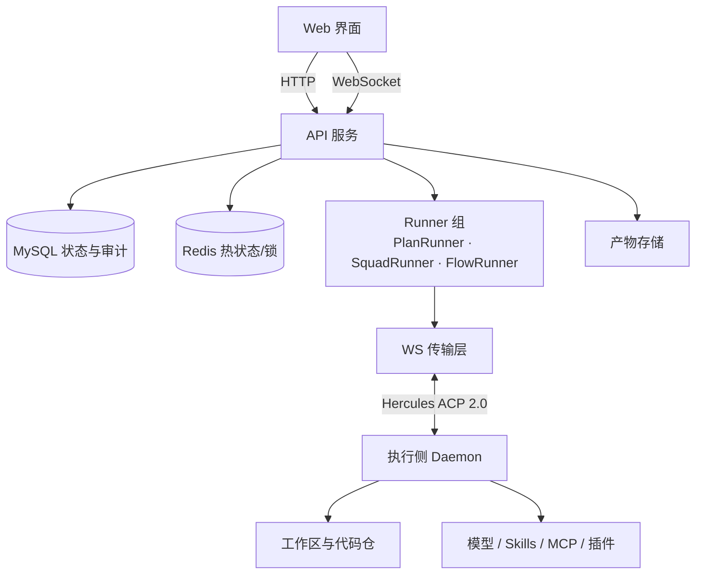
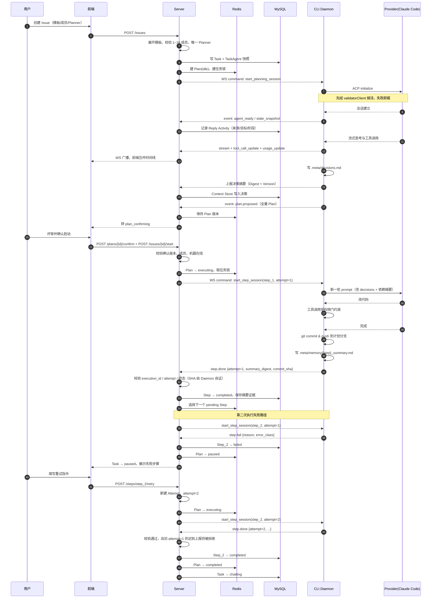

# 阿拉丁 Developer Specification（DEV_SPEC）

> 版本：1.0｜日期：2026-11-05｜状态：开发规格
>
> 用途：将阿拉丁的产品能力整理为可实现、可测试、可分阶段验收的工程规格。
> **技术栈、状态模型、数据模型与协议均在本文件内定义，实现以本文件为准。**

## 目录

1. 项目概述
2. 核心特点
3. 技术选型与关键方案
4. 测试方案
5. 系统架构与模块设计
6. 项目排期与开发任务
7. 可扩展性与未来展望
8. 验收清单与待确认事项
9. 实现契约

---

## 1. 项目概述

阿拉丁是面向研发交付的多 Agent 协同平台。用户将 TAPD、Process 或文字需求转为 Issue，配置代码仓、知识库、模板和参与 Agent，通过规划、确认、执行、验证与验收完成研发交付。

平台管理协作秩序、上下文交接和任务状态；执行侧 daemon 将代码及命令执行留在授权的开发机或云机器上。普通模式采用 Planner 与 PlanRunner；小队模式采用固定成员与 SquadRunner。

### 1.1 设计理念

- **交付驱动**：任务结果包含代码变更、验证证据和未解决事项，模型回答不等于交付完成。
- **确定性编排与模型推理解耦**：模型提出计划或执行建议，状态变更与权限检查由服务端确定性逻辑负责。
- **可恢复执行**：任务、步骤和尝试持久化，重启后先对账再恢复。
- **上下文可追溯**：摘要引用原始证据，关键约束独立保存。
- **渐进实现**：先完成一个仓库的普通模式闭环，再扩展跨机器、小队和集成。
- **实战与学习结合**：通过状态机、幂等、租约、上下文治理和评估形成可演示的工程能力；简历成果必须来自实际执行证据。

### 1.2 能力边界

| 范围 | 内容 |
|---|---|
| **任务与规划** | Issue 与 Task 为同一记录；普通模式 1–10 个 Agent 且恰好一个 Planner；Plan 提交后须用户确认才启动；普通 Plan 一次推进一个步骤；步骤失败暂停并允许重试恢复 |
| **小队模式** | 与单独 Agent 分配互斥；创建时冻结团队配置；同一 Issue 内串行推进工作项；启用开发前人类确认时先通过 Agent Review，当前方案依次完成全部审批 |
| **验收流程** | 流程模板当前仅支持 `acceptance_test`；FlowRun 具有独立快照、节点状态、重跑和取消 |
| **不在本规格** | PR Review 质量评估、SWE-bench、本地模型训练、并行 DAG；列为后续扩展（第 7 章） |

### 1.3 范围与非目标

**v1 范围 = 第 6 章的 A–E 阶段（56 个工作包）**

| 包含 | 说明 |
|---|---|
| 普通模式闭环 | 创建 → 规划 → 确认 → 串行执行 → 失败重试 → 对账 |
| 执行面全链路 | 自研 daemon：连接、会话、Provider、流式、上下文同步、Git、进程回收 |
| 上下文治理 | 三层作用域、版本仲裁、预算裁剪 |
| 可靠性 | 租约、围栏、可靠投递、背压、取消、对账 |
| 单机运行 | 单 Workspace、单仓库、单执行机器；`deploy/docker-compose.yml` 已随 A 阶段落地，完整部署、迁移与备份演练属 v2 的 I4 |

**v1 不含（属 v2，第 6 章 F–I）**：小队模式与审批链、FlowRun 验收流程、外部需求系统接入、评估体系与性能基线、多副本部署、其它 Provider（Codex / Kimi）适配。

**不在路线图上**：自动上线、自动合并 PR、任意 Agent 自由派生、并行步骤调度、自研模型训练。知识库通过适配器接入，v1 实现为 Noop。

### 1.4 成功标准

使用可复现样例完成需求输入→计划确认→代码修改→测试→人工验收；重复请求不重复创建执行；进程重启可恢复状态；取消后迟到结果不推进任务；未经授权的机器、仓库和工具调用被拒绝。实际耗时、成功率和成本由评估记录产生，不预填业务提升比例。

## 2. 核心特点

### 2.1 双执行模式

普通模式：为任务选择 Agent，唯一 Planner 探索并提交完整 Plan；人工确认并显式启动后，PlanRunner 逐步分派。

小队模式：复用负责人、成员、协作指令和审批规则；创建任务时保存配置快照，负责人持续组织工作项；不套用普通模式的 PlanRunner，也不默认所有小队都必须经过全局 Review。

### 2.2 分层上下文

身份层保存 Agent 职责与边界，项目层保存任务模板与仓库约定，任务层保存需求与决策，步骤层保存输入、结果与验证证据，会话层保存近期交互与完整历史引用。交接以结构化摘要为主，完整记录可按引用读取。

### 2.3 可靠性与执行治理

以状态机管理业务推进，以执行尝试记录失败重试，以租约与 fencing token 阻止过期执行者推进状态。网络重试与业务重试分开；恢复时先查询执行状态和工作区，再决定继续、人工处理或创建新尝试。

### 2.4 可插拔集成

模型、Agent Runtime、机器传输、知识检索、需求来源与评估器分别提供接口。MCP 用于工具能力接入，不能替代任务状态机、权限模型或机器调度协议。机器侧与 Provider 之间使用 **ACP over stdio**，其消息子集见 **9.7.1**；控制面与执行面之间使用自研的 WS 协议，见 9.7。

### 2.5 可观测与评估

统一关联 Issue、Plan、Step、Attempt、Machine 和会话；展示执行活动、工具过程、日志和产物。先以测试、状态一致性和人工验收确定结果，LLM Judge 仅作为补充。

## 3. 技术选型与关键方案

### 3.1 技术栈

| 层 | 方案 | 选择依据 |
|---|---|---|
| 语言 | **Go 1.24+** | 单二进制分发；goroutine 天然适配长连接与流式；进程组托管能力完备 |
| 前端 | **React 18 + TypeScript + Vite** | 接口契约以 9.6/9.7 为准；v1 手写 TS 类型，codegen 留作后续 |
| HTTP 服务 | **Go + chi 路由** | 标准库优先，无重型框架锁定 |
| 持久化 | **MySQL 8.0（InnoDB / utf8mb4）** | 事务、唯一约束、生成列；聚合与审计的权威源 |
| 热状态与协调 | **Redis 7** | Plan 权威态、任务锁、执行租约、恢复索引 |
| 实时通道 | **WebSocket（全双工）** | 命令下行 + 事件上行 + 心跳 + 可靠重投 |
| 机器执行 | **自研 daemon（Go 单二进制）** | 与控制面同语言；负责进程托管、工作区与上下文同步 |
| 运行时协议 | **ACP over stdio（JSONL）** | v1 只对接 Claude Code；Codex / Kimi 后续接入同一适配层 |
| 产物存储 | **本地文件 + 数据库引用** | 大日志不进入上下文，也不进入数据库 |
| 测试 | **go test + testify**（后端）；**Vitest**（前端单测） | 分层；E2E 由 `make test-e2e` 驱动真实 daemon，不引入浏览器自动化 |
| 部署 | **Docker Compose** | 服务、MySQL、Redis 可重复启动 |

依赖版本在实现时锁定并提交锁文件；引入新依赖需记录理由。

**两条架构性约束**

1. **控制面与执行面分离**：代码、登录态、模型调用不出机器；控制面只持有状态与证据。这条决定了 daemon 必须是独立进程，而不是 Server 的内嵌模块。
2. **冷热分离**：MySQL 存可重建的定义与历史，Redis 存当前推进点。**Redis 中不允许存在 MySQL 无法推导的状态**——否则 Redis 丢失即不可恢复。

### 3.2 状态机

规划、执行与验收分别建模，避免一个状态字段混合多个阶段。

**权威转换表见 9.1**。这里只强调三条容易写错的约定：

1. `chatting` 收到 `plan.appended`（增量计划）时，生成**新 revision**并回到 `plan_confirming`——追加步骤同样需要重新确认，不能直接进 `executing`。
2. 取消不是一步到位：`executing` / `paused` 先进入 `cancelling`（撤销调度资格、下发停止请求），机器确认终止或 Watchdog 超时后才到 `cancelled`；期间正在执行的 Step 记为 `cancelled`，迟到证据只入审计。
3. 结果未知的 Step 停在 `reconciling`，由对账（9.8.1）决定去 `completed` 还是 `failed`；**期间禁止重试**。

**三处必须守住的分层**

1. **Step 不含 `dispatched` / `running`**。派发是否送达由 **Session 状态**承担（`waiting_agent` / `dispatch_failed` / `dispatched`），回复进展由 **Reply Activity** 承担（阶段 + 终态）。业务状态不承载传输状态，网络抖动才不会污染业务语义。
2. **`completed` 不等于"成功"**。agent 跑完测试并交付失败报告仍是 `completed`；测试是否通过由交付物表达。用 `succeeded/failed` 会迫使系统在"谎报通过"和"丢失已完成信息"之间二选一。
3. **Flow Step 是只读投影**。FlowRun 在 Plan 中的席位映射为 `queued→pending`、`running→executing`、`succeeded→completed`、`failed|cancelled→failed`，由 FlowRunner 推进，PlanRunner 不碰。

**约束**

1. 确认绑定 `plan_id + revision + content_hash`；修改计划产生新版本并使旧确认失效。
2. `confirm` 不等于 `start`。启动时重新校验当前确认、权限、资源与状态。
3. 同一普通任务最多一个 `executing` 的 Step；下一步必须等待前一步到达终态并提交交接结果。
4. 终态不可重派。失败必须走 Retry（人工或按 3.4 策略自动），`execution_attempt` 递增。
5. 取消先撤销调度资格并发出停止请求；机器确认终止或经过对账处理后进入 `cancelled`。**不能把发出停止请求当成进程已经退出。**

### 3.3 小队与审批

创建 Issue 时冻结成员、角色、负责人、协作指令、审批配置及版本。资源展示名称可更新，执行语义使用快照。

WorkItem 状态为 proposed、reviewing、awaiting_approval、ready、running、blocked、done、cancelled。审批链以方案版本为单位依次推进；修订方案后旧审批不能继续授权新方案。关闭开发前人类确认时，不强制插入全局 Review；启用时先通过 Agent Review，再满足全部人类审批。

SquadRunner 与 PlanRunner 使用同一任务执行锁，防止因错误配置同时运行。首版不允许任务执行中切换模式。

### 3.4 执行尝试、幂等与恢复

- `Attempt` 包含 `attempt_id`、`step_id/work_item_id`、`execution_id`、租约代次、状态与结果证据。
- API 的 `Idempotency-Key` 在 Workspace 和操作范围内唯一，保存请求摘要和响应；相同键不同请求返回冲突。
- Dispatch 使用固定 `execution_id` 重发；Daemon 持久化去重记录，同一执行返回已有状态。
- 业务重试创建新 Attempt，保存重试原因、操作者和预算消耗，不覆盖失败证据。
- 租约过期增加代次；旧代次的 heartbeat/result 可以入审计，但不推进业务状态。
- 状态变更与事件写入同一数据库事务（`activities` 表即持久化事件日志）；WS 侧按事件 ID 至少一次投递，客户端按游标补拉兜底。
- 外部副作用无法普遍承诺 exactly-once：创建 PR 等操作必须使用稳定关联标识并查询对账；结果未知时进入 `reconciling`（9.8.1），禁止盲目重跑。
- 重试区分超时、机器离线、工具暂时失败、验证失败及权限错误；权限错误不自动重试，验证失败按明确策略处理。

**重试策略表**（`error_class` → 处置）

| error_class | 典型原因 | 处置 | 是否消耗重试预算 |
|---|---|---|---|
| `network` | 租约超时、机器短暂离线、连接中断 | 对账判定“未执行”后**自动**新建 Attempt | ✅ |
| `runtime` | Provider 启不起来、适配器崩溃 | 自动重试 1 次；仍失败则暂停 | ✅ |
| `tool` | 工具执行失败、外部依赖不可用 | 自动重试 1 次 | ✅ |
| `verification` | 测试失败、验收不通过 | **必须人工**给新指令 | ❌（人工重试不占预算） |
| `permission` | 授权失效、白名单变更 | **不重试**，直接失败并提示修复项 | — |

一次超过租约时长的网络抖动会先进入 `reconciling`；对账判定“未执行”后按 `network` 分支在预算内**自动**重建 Attempt 并解除 Plan 的暂停，**不应停在 paused 等人**。对账判定为“部分完成”时才转人工。

### 3.5 上下文预算与交接

建议 `ContextAssembler` 按以下顺序装配：不可丢失约束→需求与验收条件→已确认决策→当前步骤输入→最近交互→按需历史。

```typescript
interface Handoff {
  taskId: string;
  sourceAttemptId: string;
  revision: number;
  objective: string;
  decisions: Array<{ text: string; evidenceIds: string[] }>;
  changes: Array<{ repositoryId: string; commitSha?: string; artifactId?: string }>;
  verification: Array<{ command: string; exitCode: number; artifactId: string }>;
  unresolved: string[];
  nextAction: string;
}
```

预算满足 `input + tool_reserve + output_reserve <= model_window`。

**唯一的裁剪优先级表**（全文只此一份，其他章节一律引用本表）：

| 优先级 | 裁剪对象 | 手段 | 可恢复性 |
|---|---|---|---|
| 0（永不裁） | 任务约束、验收条件、已确认决策 | — | — |
| 1 | 可重取的工具输出 | 截断为「错误特征 + 头尾 + 落盘路径」 | 可从磁盘重读 |
| 2 | 旧会话历史 | 合并为摘要 | 可从 `.meta/history` 重放 |
| 3 | 非依赖步骤的摘要 | 丢弃 | 可从 Context Store 重取 |
| 4（最后） | 最近交互窗口 | 缩短 N | 影响连贯性 |

**规则**：只允许按优先级从 1 向 4 逐级裁剪；**0 级内容任何情况下不得删除**，无法保留时报错并暂停，不能静默丢弃；每次裁剪必须记录 `budget.trimmed{level, bytes}` 事件，便于事后审计。

会话恢复先校验分支、HEAD、工作区差异与原执行信息。跨 Agent 交接仅传可授权访问的证据，不继承其他 Agent 的工具权限。工具输出和需求附件作为不可信数据，不能修改平台执行策略。

### 3.6 机器执行与代码工作区

Server 只保存机器授权关系和 credential reference；原始密钥不写入任务、Prompt 或日志。Daemon 主动建立经认证通道并上报能力、心跳与执行状态。

每个任务绑定仓库集合、基线 SHA、目标分支和机器路径映射。跨机器使用统一逻辑分支不代表自动共享未提交文件；交接必须携带提交或可校验补丁，接收方校验基线及目标提交。冲突或脏工作区进入 blocked，不能自动丢弃用户更改。

执行命令、文件路径与工具调用均在机器侧再次校验。开发机授权执行不等于具备沙箱隔离；生产运行应增加专用账号、容器或工作区隔离。

### 3.7 FlowRun 验收

流程模板仅在首版支持 acceptance_test。启动时冻结模板版本、节点配置与输入。每个节点保存独立尝试与证据；重跑节点必须使依赖该结果的下游验收失效。取消后的回调不得重新将流程置为成功。

验收报告包括基线 SHA、目标 SHA、命令、退出码、日志引用及未满足条件。测试通过进入待验收；是否完成业务交付由任务验收规则决定。

### 3.8 API 设计原则

> 以下为设计原则；**具体端点、字段与错误码见 9.6**。

本节是控制面对外 HTTP 契约。所有变更请求带版本号做乐观并发控制。

| 方法与路径 | 行为 | 关键校验 |
|---|---|---|
| POST /workspaces/:wid/issues | 创建 Task 与执行配置快照 | 模式互斥、成员授权 |
| GET /issues/:id | 读取任务、计划与验收摘要 | Workspace 隔离 |
| POST /issues/:id/plans | Planner 提交计划版本 | 唯一 Planner、结构与引用校验 |
| POST /plans/:id/confirm | 确认指定版本 | revision/hash、审批权限 |
| POST /issues/:id/start | 显式启动 | 确认有效、机器与分支就绪 |
| POST /steps/:id/retry | 创建新尝试 | 状态、重试预算、对账结果 |
| POST /issues/:id/cancel | 发起取消 | 状态版本、取消权限 |
| POST /proposals/:id/approvals | 审批当前方案 | 版本、顺序、审批者 |
| POST /issues/:id/flow-runs | 启动验收 | 模板类型、输入与快照 |
| POST /issues/:id/accept | 记录人工验收 | 验证证据、验收权限 |
| GET /issues/:id/events?after=cursor | SSE 活动流 | 访问权限、顺序与补拉 |

变更请求携带 `expectedVersion`；并发修改冲突返回 409。鉴权失败、无权限、输入不合法、资源不可用、执行结果未知分别返回可机器识别的错误码。流式日志必须脱敏，且不可绕过任务访问权限。

### 3.9 可观测性设计

Agent 系统的失败是**静默**的：任务卡住时，机器离线、模型限流、工具报错、权限失效四种原因的**外部表现完全相同**。可观测性的目标不是"记录更多"，是**让不同根因在事发时刻就能被区分**。

#### 3.9.1 三层结构

| 层 | 回答什么问题 | 实现 |
|---|---|---|
| **事件（Activities）** | 业务上发生了什么 | `activities` 表，按 task 单调 `seq` |
| **日志（Logs）** | 组件内部做了什么 | 结构化 JSON 行，含关联字段 |
| **指标（Metrics）** | 整体趋势如何 | 计数 / 直方图 / 用量 |

三者的关联键统一为 `task_id + step_id + attempt_id`；日志额外带 `session_id`。

#### 3.9.2 结构化日志

**必填字段**（缺失即为缺陷）

```jsonc
{ "ts": "...", "level": "info", "component": "plan_runner",
  "task_id": "...", "step_id": "...", "attempt": 2,
  "event": "step.dispatched", "duration_ms": 42 }
```

**分级约定**

| 级别 | 用途 | 例子 |
|---|---|---|
| `error` | 需要人处理 | `step.failed`、`dispatch.failed` |
| `warn` | 自愈但需关注 | 租约过期后重试、背压触发 |
| `info` | 状态推进 | `step.dispatched`、`plan.completed` |
| `debug` | 排障 | 上下文装配明细、WS 帧大小 |

**采样**：`debug` 默认关闭；`info` 全量；高并发路径（流式片段）只记聚合值，不记每条。

#### 3.9.3 Trace 关联

一次普通任务应产生**一条**可从创建到验收追踪的链路：

```
task.created
 └─ session.dispatch (planning)
     └─ agent.prompt
         └─ tool.call × N
     └─ plan.proposed
 ├─ plan.confirmed
 ├─ step.dispatch (attempt 1)
 │   └─ agent.prompt
 │       └─ tool.call × N
 │   └─ step.done
 └─ task.chatting
```

**Span 命名规范**：`{domain}.{action}`，如 `step.dispatch`、`flow.node.claim`。
**必须记录**：开始时间、结束时间、结果（ok/err）、错误分类。

#### 3.9.4 指标

| 指标 | 类型 | 标签 | 用途 |
|---|---|---|---|
| `task_total` | counter | workspace, status | 吞吐与积压 |
| `step_duration` | histogram | step_ordinal | 找出慢步骤 |
| `failure_total` | counter | **error_class** | 区分网络/运行时/工具/验证/权限 |
| `token_usage` | counter | agent_type, model | 成本 |
| `dispatch_latency` | histogram | machine_id | 机器健康 |
| `recovery_sweep_duration` | histogram | — | Watchdog 自身健康 |
| `backpressure_events` | counter | session_id | 链路瓶颈 |

**`failure_total` 的 `error_class` 标签是这张表里最重要的**——没有它，所有失败在图表上都是一个数字。

#### 3.9.5 告警条件（最小集）

| 条件 | 含义 |
|---|---|
| `failure_total{error_class="runtime"}` 5 分钟内 > N | Provider 起不来（对应 C6 探活失败） |
| `dispatch_latency` P95 > 5s | 网络或机器异常 |
| `recovery_sweep_duration` > 30s | Watchdog 自身拖不动了 |
| 同一 `task_id` 的 `step.retried` > 3 | 步骤在反复失败 |
| `reconcile_pending` > 10 | 有大量结果未知的执行 |

#### 3.9.6 脱敏

| 对象 | 规则 |
|---|---|
| Token / API Key | 只记录长度与末四位 |
| MCP Header | 只记录键名 |
| 环境变量 | 白名单外一律不记值 |
| 工具输出 | 落盘时不过滤，**进入日志与事件时过滤** |
| Agent 提示词 | 可记哈希，不记全文 |

**实现位置**：在 logger 与 protocol 编码两处统一接入（对应 H3），而不是在各调用点手写。

#### 3.9.7 与评估的关系

可观测性回答"这次为什么失败"，评估回答"整体有没有变好"。两者数据源相同，用途不同：

| | 可观测性 | 评估 |
|---|---|---|
| 时间尺度 | 实时 | 批次 |
| 样本 | 全量 | 固定任务集 |
| 输出 | 单次根因 | 交付率、恢复率、成本 |
| 判据 | 错误分类 | 与基线对比 |

**不要把单次成功当作能力证明**——评估必须用固定任务集重复运行（见 4.3）。

## 4. 测试方案

### 4.1 分层策略

| 层级 | 覆盖范围 | 验证重点 |
|---|---|---|
| 单元 | 状态机、预算、审批、重试分类 | 非法转换被拒绝，预算与版本边界正确 |
| 契约 | Runtime、传输、知识库、工具适配器 | 同一输入输出语义，超时和取消行为一致 |
| 集成 | 数据库、Redis、FakeServer、FakeDaemon | 崩溃窗口、并发启动、租约与去重 |
| E2E | Web + API + daemon + 隔离样例仓 | 规划、确认、执行、恢复、验收闭环 |
| 真实模型评估 | 固定任务集与固定环境 | 正确性、交付率、成本、失败原因 |

测试先验证对外行为和关键不变量。模型自由文本不作为唯一断言；默认 CI 使用确定性 FakeRuntime，真实模型评估单独运行并记录模型标识与配置。

### 4.2 必测故障场景

1. 确认后修改 Plan，再启动应拒绝；重复确认不增加审批效果。
2. 两个 Runner 实例同时抢占同一步骤，只产生一个有效执行资格。
3. 状态已提交、WS 消息未送出时进程崩溃，客户端凭游标补拉不丢事件。
4. Daemon 已完成但回调丢失，恢复查询原 execution_id，不重复改码。
5. 租约过期后旧执行回调到达，不推进新尝试。
6. 取消与成功结果竞争，最终状态由事务与状态版本确定，任务不被迟到结果重新激活。
7. 方案修订后旧审批提交失败；冻结小队不受后续配置编辑影响。
8. 上下文压缩保留需求约束与验收条件，摘要可定位原始证据。
9. 跨 Workspace 任务、日志、产物、机器引用全部拒绝访问。
10. 跨机器 HEAD 不一致、脏工作区、补丁冲突时停止执行并给出证据。
11. FlowRun 重跑使下游旧结果失效，取消后节点成功回调无效。
12. PR 创建超时且结果未知时先对账，不能重复创建 PR。

**场景归属**：1–6、8 由 E10 实现；7 → F 阶段；9 → B 阶段；10 → C 阶段；11–12 → G 阶段。
每个阶段只验收属于自己的场景，避免"某阶段声称跑通全部 12 个"却依赖后续阶段的实现。

### 4.3 评估口径

- **交付成功率**：在固定预算内满足全部验收条件的任务数 / 已启动任务数；超时和失败均计入，取消单独列出并披露排除规则。
- **恢复成功率**：故障注入后无人工修复即可达到预期状态的任务数 / 注入任务数。
- **重复副作用率**：检测到重复外部副作用的执行数 / 涉及外部副作用的执行数。
- **耗时**：同时报告含审批等待的端到端耗时和不含人工等待的机器执行耗时，展示中位数及 P95。
- **成本**：记录输入/输出 token、调用次数、机器时间与缺失用量；价格使用带日期的配置快照计算。
- **Review 可选评估**：基于人工标注匹配规则计算 precision/recall；LLM Judge 分数单列，不冒充真实缺陷准确率。

评估固定仓库 SHA、任务输入、模型配置、工具权限及预算；基线和增强方案使用同一任务集，多次运行并保留逐任务结果。SWE-bench 若后续接入，单独报告，不外推为企业真实任务收益。

### 4.4 工具链与门禁

统一入口：`make lint`、`make fmt`、`make test`、`make test-integration`、`make test-e2e`、`make web-test`。
| 目标 | 覆盖 |
|---|---|
| `make lint` | `go vet ./...` + `golangci-lint run` |
| `make test` | 单测（不依赖外部服务） |
| `make test-integration` | `-tags=integration`，需 MySQL/Redis |
| `make test-e2e` | `-tags=e2e`，全链路 |
| `make web-test` | `pnpm --filter web test` |

CI：类型与静态检查→单元/契约→数据库集成→隔离 E2E。真实模型评估在受控环境手动或定期触发，失败报告保留产物与配置。

**本地验证**统一走 `deploy/docker-compose.yml`（MySQL 8.0 + Redis 7，与 CI 镜像一致）：

- `make up` 启动依赖；`make down` 停止；`make reset` 清空数据卷后重建
- `make verify` 依次执行：启动依赖 → 迁移 → 集成测试 → 单测
- 集成测试只读取 `TEST_MYSQL_DSN` / `TEST_REDIS_ADDR`，不依赖本机安装的数据库服务
- 验证必须在本机完成后再提交，CI 只作为第二道保险

## 5. 系统架构与模块设计

### 5.1 整体架构



**进程模型（已决定）**：Runner 组与 API **同进程**。理由：

1. v1 规模下单进程足够，少一个部署单元与一套健康检查；
2. Runner 需要在同一事务/同一内存视图里读任务状态，跨进程会引入额外的一致性问题；
3. 任务锁仍然保留——**部署多副本时它才是必需的**；单副本下它是廉价的保险。

**代价**：API 重启会中断正在推进的轮次。缓解：Runner 每一轮只是**数据库短事务**；任务锁从 `start` 起由当前 Runner 持续持有到任务终态，不随轮次释放（见 9.8），因此重启后 Watchdog 以 MySQL 为驱动发现无锁的 `executing` 任务并重新接管。`max_active_steps_per_task = 1` 保证任意时刻最多一个未完成的推进。

**升级路径**：若将来需要分离，Runner 只需从 `cmd/server` 拆到独立入口（如 `cmd/runner`），接口层（`Runtime`、`ContextStore`）无需改动。

### 5.2 目录结构

单一 Go module，三个入口（`server`、`daemon`、`aladdin` CLI），前端独立 workspace。

```text
aladdin/
├── cmd/
│   ├── server/main.go            # 控制面入口（API + Runner 同进程）
│   ├── daemon/main.go            # 执行面入口（每台机器一个）
│   └── aladdin/main.go           # 运维 CLI：daemon status/logs、migrate、reset
├── internal/
│   ├── config/                   # 配置加载与校验（server / daemon 两套）
│   ├── domain/                   # 领域类型与状态机（无外部依赖）
│   ├── httpapi/                  # B0：chi 路由、中间件、统一响应与错误码映射
│   ├── auth/                     # B2：权限判定与鉴权中间件
│   ├── task/                     # 任务创建、模板展开、成员校验
│   ├── plan/                     # 计划提交、版本、确认、启动
│   ├── agent/                    # B3：Agent 配置、可见性与可调度性
│   ├── machine/                  # B10：机器注册、能力与心跳
│   ├── health/                   # A8：启动自检与健康检查
│   ├── orchestration/            # PlanRunner / SquadRunner / FlowRunner / 任务锁
│   ├── session/                  # 会话生命周期、派发、指纹恢复
│   ├── agentctx/                 # Context Store、装配、预算、版本仲裁（避开标准库 context）
│   ├── activity/                 # 事件流与游标
│   ├── daemon/                   # C 阶段：连接、命令分发、会话、流、Git、进程回收
│   ├── state/                    # D3：CLI 侧流状态机（与 domain 状态机不共享代码）
│   ├── capability/               # Skill / MCP / Plugin 解析与授权
│   ├── recovery/                 # Watchdog、对账
│   ├── transport/
│   │   ├── ws/                   # WebSocket 服务端：握手、命令、事件、可靠投递
│   │   └── acp/                  # ACP 客户端：Provider 启停、流式、权限询问
│   ├── store/
│   │   ├── mysql/                # 仓储与迁移
│   │   └── redis/                # 键封装、锁、租约
│   ├── observability/            # 日志、trace、指标、脱敏
│   ├── squad/                    # v2：小队快照、方案、审批链
│   ├── flow/                     # v2：流程模板、运行、节点
│   ├── integration/              # v2：TAPD / Process 适配
│   ├── evaluation/               # v2：评估 runner 与报告
│   └── testkit/                  # 测试夹具：FakeRuntime、FakeServer、临时 DB/Redis
├── pkg/
│   ├── protocol/                 # WS 消息信封与编解码（前后端共享的结构定义）
│   └── errcode/                  # 错误码与失败分类
├── migrations/                   # SQL 迁移（up/down）
├── web/                          # React + TS + Vite
│   └── src/{pages,components,api,hooks}
├── tests/
│   ├── integration/              # 依赖真实 MySQL/Redis（-tags=integration）
│   ├── e2e/                      # 全链路（-tags=e2e）
│   ├── perf/                     # 基线（-tags=perf）
│   └── fixtures/                 # 样例仓库、脚本化对端、ACP conformance（tests/fixtures/acp）、评估任务集
├── scripts/                      # 工具脚本（create-issues.py 等）
├── deploy/                       # docker-compose、初始化脚本
├── docs/                         # ADR、证据归档
├── config/config.yaml
├── Makefile
└── go.mod
```

**分层依赖方向**：`domain` 不依赖任何其他包；`store` / `transport` 依赖 `domain`；`orchestration`、`recovery` 依赖 `store` 与 `transport`；`httpapi` 只依赖服务层（`task` / `plan` / `orchestration` 等），服务层不得反向依赖它；`cmd` 只做装配。**禁止反向依赖**，用 `go list -deps` 在 CI 中校验。

### 5.3 模块职责

| 模块 | 对外能力 | 不承担的职责 |
|---|---|---|
| TaskService | 创建、启动、取消、验收 | 模型推理细节 |
| PlanningService | 计划提交、版本与确认 | 执行命令 |
| PlanRunner | 串行步骤推进与交接 | 小队动态协调 |
| SquadRunner | 负责人工作项与审批推进 | 普通 Plan 执行 |
| ContextService | 预算、摘要与证据引用 | 授权其他工具 |
| ExecutionService | 尝试、租约、执行对账 | 假设命令天然幂等 |
| MachineAdapter | 调度、查询、停止与能力协商 | 决定业务成功 |
| FlowRunner | 验收节点、重跑和取消 | 自动部署 |
| ResourceService | 资源授权、配置与快照 | 保存明文凭据到任务 |
| ActivityService | 事件、日志、追踪与脱敏 | 直接修改任务状态 |

### 5.4 数据模型

> 以下为实体关系与设计意图；**完整 DDL 见 9.3**。

| 实体 | 关键字段与约束 |
|---|---|
| Workspace / Membership | id、用户、角色；全部资源按 Workspace 授权 |
| Task | workspace_id、created_by、mode、status、version、config_snapshot（JSON，不可变）、cancel_requested_at |
| TaskAgent | task_id、agent_id、role；普通模式提交执行前校验唯一 Planner |
| Plan / Step | task_id、revision、hash、ordinal、status；计划版本和步骤顺序唯一 |
| Confirmation | plan_id、revision、hash、actor、timestamp；确认不可移用于新版本 |
| SquadSnapshot | 成员、负责人、协作指令、审批规则及其来源版本 |
| Proposal / Approval | proposal_revision、顺序、审批者、结论与证据 |
| WorkItem | task_id、proposal_revision、owner、status、version |
| Attempt | 执行对象、attempt_no、execution_id、lease_epoch、状态、错误分类 |
| ExecutionLease | task_id、owner、epoch、expires_at；每任务一个当前租约 |
| Handoff / Decision | 来源尝试、版本、证据引用、访问范围 |
| FlowRun / FlowNodeRun | 模板快照、输入、节点依赖、attempt 与结果有效性 |
| Activity | 单调游标、事件 ID、聚合版本；`activities` 即持久化事件日志 |
| Artifact | 对象位置、hash、大小、内容类型、访问范围与保留策略 |
| IdempotencyRecord | Workspace、操作、key、请求摘要、结果；组合唯一 |

时间统一存 UTC，展示按用户时区转换。**MySQL 侧必须设置连接参数 `time_zone='+00:00'`**——`DATETIME` 不带时区，否则 `CURRENT_TIMESTAMP` 会取会话时区。所有任务派生记录必须可追溯到 Workspace。大日志存产物，数据库存引用；删除、保留期限和审计归档在部署前确定。

### 5.5 核心接口

```go
// 控制面 → 执行面的唯一通道。所有实现必须说明：取消语义、超时、
// 状态保留周期、幂等支持、能力缺失时的报错方式。不支持的能力显式报错，
// 绝不返回"虚假成功"。
type Runtime interface {
    Dispatch(ctx context.Context, req DispatchRequest) (executionID string, err error)
    Inspect(ctx context.Context, executionID string) (ExecutionSnapshot, error)
    Cancel(ctx context.Context, executionID string) (acknowledged bool, err error)
    Capabilities() CapabilitySet
}

// 执行面内部的 Provider 适配（v1 只接 Claude Code；接口按多 Provider 设计，
// 归一化层不能因为只有一家就省略）
type Provider interface {
    Start(ctx context.Context, cfg ProviderConfig) (Session, error)
    Resume(ctx context.Context, acpSessionID string) (Session, error)
    Validate(ctx context.Context, cfg ProviderConfig) error // 派发前探活
}

// 上下文装配与交接。
type ContextStore interface {
    Put(ctx context.Context, e Entry, expectedVersion int) (version int, err error)
    Get(ctx context.Context, kind Kind, scopeID string) (Entry, error)
    Assemble(ctx context.Context, req ContextRequest) (ContextBundle, error)
}

// 知识检索（可插拔，MVP 可实现为不做任何事的 Noop）。
type KnowledgeProvider interface {
    Search(ctx context.Context, q KnowledgeQuery) ([]EvidenceRef, error)
}
```

**四个接口的分界**

| 接口 | 归属 | 谁实现 |
|---|---|---|
| `Runtime` | 控制面视角 | WS 传输层（真实）/ FakeRuntime（测试） |
| `Provider` | 执行面视角 | ACP 客户端，每种 Provider 一个薄适配 |
| `ContextStore` | 控制面 | MySQL + Redis 组合实现 |
| `KnowledgeProvider` | 可插拔 | MVP 用 Noop，后续接真实检索 |

**测试要求**：`Runtime` 与 `Provider` 各必须有两个实现——真实的一个和 Fake 的一个。这是 B5 与 C5 工作包的验收前提。

### 5.6 配置驱动

配置分三层：**默认值 → 配置文件 → 环境变量**，后者覆盖前者。启动时校验必填项并 fail-fast，错误信息必须含字段路径。

**敏感项**（数据库 DSN、机器令牌、Provider 凭据）只从环境变量读取，不写入配置文件。

完整配置项清单见 **9.9**。

### 5.7 Web 功能页面

#### 5.7.1 页面与路由

| 路由 | 页面 | 核心区块 |
|---|---|---|
| `/issues` | 任务列表 | 状态筛选、创建入口 |
| `/issues/{id}` | **Issue 驾驶舱** | 概览 / 计划 / 执行时间线 / 恢复 / 证据 |
| `/issues/{id}/squad` | 小队协作区 | 方案、审批、交接历史、事件 |
| `/flow-runs` | 运行中心 | 列表、详情、日志、重跑、取消 |
| `/agents` · `/machines` | 资源 | Agent 配置、机器状态与能力（v1 只做只读列表） |
| `/templates` | 模板 | 任务模板与流程模板（v1 只做只读列表） |
| `/settings` | 设置 | 成员、Plugin/MCP/Skill（v1 不做） |

#### 5.7.2 驾驶舱的五个区块

| 区块 | 展示 | 数据来源 | 刷新 |
|---|---|---|---|
| 概览 | Task 状态、当前阶段、Planner | `GET /issues/{id}` | 事件驱动 |
| 计划 | Plan 版本、步骤列表、依赖、分配 | `GET /issues/{id}/plans/{rev}` | 手动/事件 |
| **执行时间线** | 消息、工具调用、用量、状态变化 | `GET /issues/{id}/events?after=` | **增量推送** |
| **恢复区** | 失败步骤、错误分类、重试入口、待对账项 | 同上 + `step.fail` 事件 | 事件驱动 |
| 证据 | 摘要、commit、产物、验收报告 | `artifacts` | 按需 |

#### 5.7.3 状态 → UI 映射

| Task 状态 | 主操作 | 禁用项 |
|---|---|---|
| `pending` | —（等待规划） | 启动 |
| `plan_confirming` | 确认并启动 / 驳回 | 取消 |
| `executing` | 查看 / 取消 | 确认、启动 |
| `paused` | 存在 `reconciling` 步骤时：等待对账（重试禁用）；否则：**重试失败步骤** / 取消 | 启动；对账期间另禁用重试 |
| `cancelling` | —（等待机器确认停止） | 全部变更操作 |
| `chatting` | 继续对话 / 新增计划 | 重试 |
| `cancelled` / `failed` | 只读 | 全部变更操作 |

**原则**：按钮可用性由服务端状态 + 权限共同决定，前端禁用只是提示，**不能替代服务端校验**。

#### 5.7.4 实时更新

```
进入驾驶舱 → GET /events?after=0 拉全量 → 记录 nextSeq
          → 建立 SSE/WS → 收到 seq 后比对：> 本地最大 seq 才渲染
断线重连   → 携带本地最大 seq → 服务端从 seq+1 补拉
```

- 游标比较用 `seq > cursor`，**不能用 `= cursor + 1`**（seq 允许有洞，见 9.3）
- 同一 `event_id` 重复到达时丢弃
- 本地不缓存权威状态：刷新页面必须以服务端为准

#### 5.7.5 失败与恢复的展示要求

| 场景 | 必须显示 |
|---|---|
| 步骤失败 | 错误分类（network / runtime / tool / verification / permission）、原始错误、所属 attempt |
| 机器离线 | `waiting_agent` 状态、目标机器、当前是否可唤醒 |
| 结果未知 | **"待对账"**，且重试按钮置灰，附对账入口 |
| 取消中 | `cancelling`，并说明"停止请求已发出，等待机器确认" |

**最后一条尤其重要**：不能把"已发停止请求"显示成"已停止"。

### 5.8 数据流说明

前面 9.2 是**时序视角**（谁在什么时候做什么），本节是**数据视角**（一份数据从哪来、变成什么、存在哪）。

#### 5.8.1 任务定义数据

```
创建请求（模板 ID + 成员 + 仓库 + 约束）
   ↓ 展开 + 去重
config_snapshot (JSON)  ──写入──►  tasks.config_snapshot   【不可变】
   ↓
每次派发时读取，与 planning prompt 一起下发
```

**不可变性是重点**：任务创建后修改模板，不改变已有任务的快照。

#### 5.8.2 计划数据

```
Planner 提交（content_md + steps[]）
   ↓ 校验 agent_ref、ordinal 唯一
plans(revision, content_hash) + plan_steps(ordinal, status)   【版本化，只追加】
   ↓ 用户确认
confirmations(plan_id, revision, content_hash)              【绑定版本】
   ↓ 启动
Redis plan:{task_id} = { status, revision, current_step_id } 【热状态】
```

**冷热分离**：MySQL 存定义与历史（可重建），Redis 存当前推进点（可丢失后重建）。

#### 5.8.3 执行数据

```
Server 派发 (execution_id, attempt_no)
   ↓ WS command
CLI 执行 → 产生 stream / tool_call / usage
   ↓ WS event/stream
Server 写入：attempts（状态、digest、commit_sha）
             reply_activities（阶段、终态）
             activities（seq 单调的事件流）
```

**同一次执行产生三类数据**：状态（attempts）、回复生命周期（reply_activities）、可回放事件（activities）。

#### 5.8.4 上下文数据

```
CLI 本地 .meta/decisions.md          ──push──►  context_entries(kind=decisions)
CLI 本地 .meta/memory/{step}_summary.md ──push──► context_entries(kind=step_summary)
CLI 本地 .meta/history/*.jsonl       ──不上传──►  仅本地诊断
```

| 数据 | 权威方 | 方向 |
|---|---|---|
| `decisions` / `step_summary` | **Server** | CLI 推上去，Server 版本仲裁后回灌 |
| `history/*.jsonl` | **CLI 本地** | 单向，不参与交接 |

**版本仲裁**：每次写入带 `expectedVersion`，冲突时重读合并（见 9.4 CAS）。

#### 5.8.5 大产物数据

```
工具输出 > 阈值
   ↓
全文落盘  <workdir>/.artifacts/{step-id}/{call-id}.log
   ↓
上下文只放：错误特征行 + 头尾 + 行号分布 + 路径
   ↓
artifacts 表记录 sha256 / size / path（可选，用于跨机访问）
```

**不变量**：上下文里永远不出现完整大日志；Agent 通过 shell 按路径自行读取。

#### 5.8.6 事件流数据

```
任何状态变更
   ↓ 同一事务
UPDATE tasks SET activity_seq = activity_seq + 1   ← 分配序号
INSERT activities(task_id, seq, event_id, kind, payload)
   ↓
前端按 seq > cursor 增量拉取
```

**seq 在同一事务内单调分配**：回滚会同时撤销计数器与事件，因此正常情况下**无洞**。洞只可能来自事件归档删除或将来的批量补写。客户端仍统一用 `seq > cursor` 读取，以兼容这两种情况。

## 6. 项目排期与开发任务

以下是开发的全部工作包。每项完成需关联代码、测试与演示证据，进度记录见 6.4。

### 6.1 阶段总览

| 阶段 | 目标 | 前置 | 包数 | 建议工作量 |
|---|---|---|---|---|
| A | 工程骨架与领域契约 | 无 | 8 | 8–12 人日 |
| B | 服务端协议基座（HTTP / WS / 可靠投递） | A | 11 | 12–18 人日 |
| C | **Daemon 与运行时**（执行面全链路） | B | 13 | 16–24 人日 |
| D | 普通模式闭环（规划→确认→执行→重试） | B、C | 14 | 16–24 人日 |
| E | 上下文与故障恢复 | D | 10 | 12–18 人日 |
| F | 小队与审批 | E | 8 | 12–18 人日 |
| G | 验收流程与外部集成 | E | 8 | 10–16 人日 |
| H | 可观测与评估 | D 起步；E–G 补齐 | 7 | 8–12 人日 |
| I | E2E、部署与文档收口 | 全部 | 6 | 8–12 人日 |

**合计 102–154 人日**，不含组织审批与运维。按每包 1.2–1.8 人日估算（实现 + 单测 + 验收 + 证据归档）。
**A–E（56 包）构成最小可用闭环，约 64–96 人日**；**F–I 属 v2**，在闭环验证后再投入。

> **工作包拆分**：6.2 将上述阶段拆为 **85 个工作包**（A 8 / B 11 / C 13 / D 14 / E 10 / F 8 / G 8 / H 7 / I 6），每包含目标、具体文件、函数签名、验收标准与可直接执行的测试命令。进度跟踪见 6.4。

### 6.2 开发工作包

> **路径约定**：以下路径与 5.2 的目录结构一一对应，两者必须一致；修改任一处须在同一提交内同步另一处。目录树是工作包的投影，不是相反。
>
> 每个工作包五个字段：**目标 / 文件 / 实现 / 验收 / 测试**。测试命令是可直接执行的。
> 未标注 `-tags=integration` 的测试默认不依赖外部服务。

#### 阶段 A：工程骨架与契约（8 包）

**A1：Go module 与可运行入口**
- 目标：建立 module 与 server / daemon / aladdin 三个入口。
- 文件：`go.mod`、`cmd/server/main.go`、`cmd/daemon/main.go`、`cmd/aladdin/main.go`、`Makefile`
- 实现：`main()`；Makefile 目标 `build / test / lint`
- 验收：`make build` 产出 `bin/server`、`bin/daemon`、`bin/aladdin`；`go vet ./...` 无告警。
- 测试：`make build && ./bin/server --health`

**A2：配置加载与校验**
- 目标：读取 9.9 配置，缺关键字段时 fail-fast。
- 文件：`internal/config/config.go`、`config/config.yaml`、`internal/config/config_test.go`
- 实现：`Load(path string) (*Config, error)`；`(*Config) Validate() error`（错误信息含字段路径）
- 验收：缺 `storage.mysql_dsn` 时报错明确指出该路径；完整配置可加载。
- 测试：`go test ./internal/config -run TestValidate -v`

**A3：测试基座与 CI**
- 目标：统一测试入口，集成测试与单测分离。
- 文件：`internal/testkit/db.go`、`internal/testkit/redis.go`、`.github/workflows/ci.yml`
- 实现：`testkit.NewDB(t) *sql.Tx`（用后自动回滚）；`testkit.NewRedis(t) *redis.Client`
- 验收：`go test ./...` 不依赖外部服务；`-tags=integration` 时才连真实 MySQL/Redis；前端测试（`make web-test`）为独立 job。
- 测试：`go test ./... -count=1`

**A4：领域类型与状态枚举**
- 目标：定义 Task / Plan / Step / Attempt 的状态与结构。
- 文件：`internal/domain/task.go`、`internal/domain/plan.go`、`internal/domain/step.go`、`internal/domain/attempt.go`
- 实现：`type TaskStatus string` 及常量；`IsTerminal() bool`；`Valid() error`
- 验收：未知状态值反序列化报错；终态判定与 9.1 一致。
- 测试：`go test ./internal/domain -run TestStatus`

**A5：状态转换守卫**
- 目标：把 9.1 的转换表落成代码，非法转换拒绝。
- 文件：`internal/domain/transition.go`、`internal/domain/transition_test.go`
- 实现：`(*Task).CanTransition(ev Event) error`；`(*Task).Apply(ev Event) error`（对 Plan/Step 同理）
- 验收：表驱动覆盖 9.1 全部行；每行附一条"应被拒绝"的反例。
- 测试：`go test ./internal/domain -run TestTransition -v`

**A6：MySQL 迁移**
- 目标：落地 9.3 的 DDL，空库可执行。
- 文件：`migrations/0001_init.up.sql`、`migrations/0001_init.down.sql`、`internal/store/mysql/migrate.go`
- 实现：`Migrate(dsn string) error`；`MigrateDown(dsn string, steps int) error`
- 验收：空库 up→down→up 幂等；插入第二个 planner 触发 `uk_one_planner` 冲突（1062）。
- 测试：`go test ./internal/store/mysql -tags=integration -run TestMigrate`

**A7：Redis 键封装与锁**
- 目标：封装 9.4 的键，禁止散落字符串；实现可比较 owner 的锁。
- 文件：`internal/store/redis/client.go`、`internal/store/redis/keys.go`、`internal/store/redis/lock.go`
- 实现：`Keys.Plan(taskID)` / `Keys.TaskLock(taskID)` / `Keys.Lease(attemptID)`；`AcquireLock(ctx, key, owner, ttl)`；`ReleaseLock(ctx, key, owner)`（Lua 比对）
- 验收：非持有者释放失败；TTL 到期后可被他人获取。
- 测试：`go test ./internal/store/redis -tags=integration -run TestLock`

**A8：启动自检与健康检查**
- 目标：启动时校验 MySQL/Redis 可达与迁移版本。
- 文件：`internal/health/health.go`、`cmd/server/main.go`
- 实现：`health.Check(ctx) error`；路由 `GET /healthz`、`GET /readyz`
- 验收：停掉 Redis 后 `/readyz` 返回 503，`/healthz` 仍 200。
- 测试：`curl -s -o /dev/null -w '%{http_code}' localhost:8080/readyz`

#### 阶段 B：资源授权与机器契约（11 包）

**B0：HTTP 基座**
- 目标：chi 路由装配、中间件链、统一响应与错误码映射。
- 文件：`internal/httpapi/router.go`、`internal/httpapi/middleware.go`、`internal/httpapi/respond.go`
- 实现：`NewRouter(deps) http.Handler`；中间件：`Recover`→`RequestID`→`Trace`→`Auth`→`WorkspaceScope`；`RespondError(w, err)` 按 9.6 错误码表映射
- 验收：未命中路由返回统一错误体；panic 被 `Recover` 捕获并返回 500；错误码不在 9.6 表内时构建期即失败（用常量生成校验）。
- 测试：`go test ./internal/httpapi -run TestRouter -v`

**B1：Workspace / Member 仓储**
- 目标：工作区与成员的持久化与查询。
- 文件：`internal/store/mysql/workspace.go`
- 实现：`CreateWorkspace`、`AddMember(wsID, userID, role)`、`MemberRole(wsID, userID) (Role, error)`
- 验收：重复添加成员触发主键冲突；不可跨工作区查询到成员。
- 测试：`go test ./internal/store/mysql -tags=integration -run TestWorkspace`

**B2：权限判定器（9.5 矩阵）**
- 目标：把权限矩阵落成一个可测试的纯函数。
- 文件：`internal/auth/policy.go`、`internal/auth/policy_test.go`、`internal/auth/middleware.go`
- 实现：`Can(actor Actor, action Action, res Resource) bool`；`RequireRole(min Role) Middleware`
- 验收：表驱动覆盖 9.5 全部格子；viewer 创建 Issue 返回 403。
- 测试：`go test ./internal/auth -run TestPolicyMatrix -v`

**B3：Agent Config 与实例**
- 目标：Agent 配置的可见性与可调度性。
- 文件：`internal/agent/config.go`、`internal/store/mysql/agent.go`
- 实现：`CreateConfig`、`ListSchedulable(wsID, userID)`
- 验收：private 仅 owner 可见；shared 转 private 后跨用户派发返回 `AGENT_UNAVAILABLE`。
- 测试：`go test ./internal/agent -run TestVisibility`

**B4：任务创建与模板展开**
- 目标：实现 9.6 的 `POST /issues`，含模板合并与快照。
- 文件：`internal/task/service.go`、`internal/task/template.go`、`internal/store/mysql/task.go`
- 实现：`Create(ctx, CreateTaskReq) (*Task, error)`；`expandTemplate(tpl, req) config`
- 验收：agent_ids 1–10 唯一、planner 必属成员、跨工作区拒绝；config_snapshot 落库且不可变。
- 测试：`go test ./internal/task -run TestCreate -v`

**B5：FakeRuntime（假 ACP 对端）** ← D 阶段的前置
- 目标：提供一个可编排应答的假 Runtime，让闭环测试不依赖真实模型。
- 文件：`internal/testkit/fakeruntime/runtime.go`、`internal/testkit/fakeruntime/script.go`、`tests/fixtures/scripts/basic.yaml`
- 实现：`New(script) *Runtime`；实现与 C5 相同的 Provider 边界（9.7.1 的 `AgentEvent` 归一化模型）；按脚本回放 `stream_delta`、`tool_call`、`turn_done`、`step_done`、`step_fail`
- 验收：可注入三种故障——中途断连、返回失败、超时不响应；脚本不得依赖任何 Provider 的原始报文格式。
- 测试：`go test ./internal/testkit/fakeruntime -run TestScript -v`

**B6：WS 服务端骨架**
- 目标：握手、心跳、断线检测。
- 文件：`internal/transport/ws/server.go`、`internal/transport/ws/handshake.go`
- 实现：`HandleUpgrade`、`HandleHandshake`、`(*Conn).Tick()`（30s）
- 验收：握手成功后才能收命令；token 无效返回 401 并断开；90s 无心跳断开。
- 测试：`go test ./internal/transport/ws -run TestHandshake`

**B7：WS 消息编解码**
- 目标：实现 9.7 的信封与校验。
- 文件：`pkg/protocol/envelope.go`、`pkg/protocol/codec.go`
- 实现：`Encode(Envelope) ([]byte, error)`；`Decode([]byte) (Envelope, error)`；校验 `version` / `type` / 执行类必填 `execution_attempt`
- 验收：未知 `type` 拒绝；执行类消息缺 `execution_attempt` 拒绝。
- 测试：`go test ./pkg/protocol -run TestCodec -v`

**B8：命令下发与响应配对**
- 目标：按 `id` 配对响应，支持超时与取消。
- 文件：`internal/transport/ws/dispatcher.go`
- 实现：`Dispatch(ctx, Command) (Response, error)`；`Cancel(id)`
- 验收：并发 100 条命令不串号；超时命令可通过 ctx 取消且不泄漏 goroutine。
- 测试：`go test ./internal/transport/ws -run TestDispatchConcurrent -race`

**B9：事件去重与可靠重投**
- 目标：至少一次投递 + 接收端幂等。
- 文件：`internal/transport/ws/reliable.go`、`internal/store/redis/unacked.go`
- 实现：`TrackUnacked(id)`、`MarkAcked(id)`、`ResendLoop(ctx)`；按 `id` 去重
- 验收：未 ack 消息 5s 后重投且 `id` 不变；重复到达只处理一次。
- 测试：`go test ./internal/transport/ws -run TestReliable -race`

**B10：机器注册与能力上报**
- 目标：记录机器能力，用于是否下发附件类命令。
- 文件：`internal/machine/registry.go`、`internal/store/mysql/machine.go`
- 实现：`Register(machineID, caps)`、`Heartbeat(machineID)`、`Supports(cap) bool`
- 验收：未声明 `attachments` 能力的机器不下发附件命令。
- 测试：`go test ./internal/machine -run TestCapabilities`

#### 阶段 C：Daemon 与运行时（13 包）

> 执行面自研，与控制面同语言。这一阶段的产出是每台执行机器上的单一二进制。

**C1：Daemon 进程入口与 Profile**
- 目标：独立二进制，按 `machine-id` 解析 Profile，支持多实例并行。
- 文件：`cmd/daemon/main.go`、`internal/daemon/boot.go`、`internal/config/daemon.go`
- 实现：`boot.Run(ctx, Options) error`；profile 目录解析为 `~/.aladdin/profiles/<machine-id>/`
- 验收：缺配置时启动失败并指出字段；两个不同 `--profile` 可同时运行互不干扰。
- 测试：`go test ./internal/daemon -run TestBoot -v`

**C2：控制面连接（握手 / 心跳 / 重连）**
- 目标：与 Server 建立 WS，断线后指数退避重连。
- 文件：`internal/daemon/conn.go`、`internal/daemon/backoff.go`
- 实现：`Connect(ctx) error`、`HandleHandshake`、`Heartbeat(interval)`、`Reconnect()`
- 验收：断网 30s 内自动重连；握手被拒时不无限重试；心跳含版本与能力。
- 测试：`go test ./internal/daemon -run TestReconnect -v`

**C3：命令分发与幂等**
- 目标：按 command id 去重，重复命令返回上次结果。
- 文件：`internal/daemon/dispatcher.go`、`internal/daemon/idempotent.go`
- 实现：`Dispatch(cmd Command)`；去重记录**落盘**到 `~/.aladdin/profiles/<machine-id>/commands.jsonl`（与 C4 的 session_history 同目录），保留 24h
- 验收：daemon 重启后同一 command id 仍被识别为重复；LRU 仅作为内存加速层，不承担正确性。
- 测试：`go test ./internal/daemon -run TestIdempotent -v`

**C4：会话管理与本地历史**
- 目标：维护 Server Session ↔ Provider Session 映射并持久化。
- 文件：`internal/daemon/session.go`、`internal/daemon/history.go`
- 实现：`EnsureSession`、`ResumeOrCreate`、`Stop`；`session_history.json` 读写（原子替换）
- 验收：进程重启后映射可读回；写文件用临时文件 + rename，不产生半写。
- 测试：`go test ./internal/daemon -run TestSessionHistory -v`

**C5：ACP 客户端与 Provider 启停**
- 目标：按 agent_type 拉起子进程，走 ACP over stdio（JSONL）。
- 文件：`internal/transport/acp/client.go`、`internal/transport/acp/process.go`
- 实现：`Spawn(ctx, cfg) (Session, error)`；按 **9.7.1** 实现 `initialize` / `authenticate` / `session/new` / `session/load` / `session/prompt` / `session/cancel`，并把报文归一化为 `AgentEvent`；子进程按进程组托管
- 验收：子进程崩溃可被检测；停止时连带回收其派生的 build/test 进程；Claude Code 的 conformance fixture 回放通过（含未知 update 被忽略并计数、未知 request 返回 `-32601`）。
- 测试：`go test ./internal/transport/acp -run TestSpawn -v`

**C6：运行时探活**
- 目标：派发真实工作前先 `initialize` 探活，失败在业务状态之前暴露。
- 文件：`internal/transport/acp/validate.go`
- 实现：`Validate(ctx, cfg) error`，默认 3s 超时
- 验收：Provider 起不来、协议版本不兼容或未登录时不创建会话，返回 `RUNTIME_START_FAILED`（detail 带原因）；耗时应为毫秒级。
- 测试：`go test ./internal/transport/acp -run TestValidate -v`

**C7：流式回传与背压**
- 目标：把 Provider 输出转成 WS stream；消费变慢时暂停。
- 文件：`internal/daemon/stream.go`、`internal/daemon/backpressure.go`
- 实现：`(*Streamer).Append(delta)`、`Flush()`；`Paused() bool`、`WaitResume(ctx)`
- 验收：下游慢时暂停发送而非堆内存；持续背压超过阈值终止会话并上报。
- 测试：`go test ./internal/daemon -run TestStreamBackpressure -v`

**C8：工具调用状态机**
- 目标：配对 tool_call 与 tool_result，配对状态不依赖消息历史。
- 文件：`internal/daemon/toolstate.go`
- 实现：`StartToolCall(id)`、`UpdateToolCall(id, result)`、`Open() []ToolCall`
- 验收：1e4 次调用后配对严格相等；中断后可列出未闭合的调用并据此恢复。
- 测试：`go test ./internal/daemon -run TestToolPairing -v`

**C9：上下文同步与版本缓存**
- 目标：与 Server 双向同步 decisions / step_summary，本地维护版本。
- 文件：`internal/daemon/contextsync.go`、`internal/daemon/meta.go`
- 实现：`Pull()`、`PushDecisions()`、`PushSummary()`；`.context_versions.json` 读写
- 验收：本地版本落后时先拉取再合并；冲突时重读，不覆盖。
- 测试：`go test ./internal/daemon -run TestContextSync -v`

**C10：工作区与 Git 操作**
- 目标：准备仓库、切分支、查 diff/commit、推送。
- 文件：`internal/daemon/workspace.go`、`internal/daemon/git.go`
- 实现：`Prepare(repos)`、`Diff(range)`、`Commits(range)`、`Push(branch)`
- 验收：脏工作区不被清理；非计划分支拒绝推送；HEAD 与基线不一致时停止并回传证据。
- 测试：`go test ./internal/daemon -run TestWorkspace -v`

**C11：Flow 节点 Worker**
- 目标：领取并执行 `agent_prompt` 节点。
- 文件：`internal/daemon/flownode.go`
- 实现：`Claim()`、`Heartbeat(nodeID, lease)`、`Complete()`、`Fail()`、`CancelAck()`
- 验收：租约过期后节点可被重新领取；旧 claim 的 complete 被拒绝。
- 测试：`go test ./internal/daemon -run TestFlowNode -race`

**C12：进程回收**
- 目标：停止、取消、异常退出时回收子进程组。
- 文件：`internal/daemon/reap.go`
- 实现：`ReapOnExit()`；PID + 进程身份双校验
- 验收：`kill -9` daemon 后其派生的 Provider 进程被清理；重启后不误杀 PID 复用的进程。
- 测试：`go test ./internal/daemon -run TestReap -v`

**C13：FakeServer 测试夹具**
- 目标：本地可脚本化的 WS 对端，让 daemon 测试不依赖真实 Server。
- 文件：`internal/testkit/fakeserver/server.go`、`tests/fixtures/scripts/`
- 实现：`New(t, script) *Server`；可注入断连、乱序、重复投递、握手拒绝
- 验收：C2/C3/C7 的测试全部基于 FakeServer 通过。
- 测试：`go test ./internal/testkit/fakeserver -run TestScript -v`
#### 阶段 D：普通模式闭环（14 包）

**D1：规划会话创建与派发**
- 目标：任务创建后创建 planning Session 并派发。
- 文件：`internal/session/service.go`、`internal/session/dispatch.go`
- 实现：`EnsureSession(taskID, agentID, kind)`；`DispatchPlanning(ctx, taskID)`
- 验收：机器离线时 Session 置 `waiting_agent`，不报错；机器在线时 200ms 内下发。
- 测试：`go test ./internal/session -run TestDispatchPlanning`

**D2：规划上下文装配**
- 目标：按 3.5 的顺序组装规划提示词。
- 文件：`internal/agentctx/assembler.go`
- 实现：`Assemble(ctx, ContextRequest) (ContextBundle, error)`（**不做裁剪**，裁剪由 E2 的 `Fit` 负责）
- 验收：装配顺序与 3.5 一致；装配结果交给 `Fit` 后仍保留全部约束类内容。
- 测试：`go test ./internal/agentctx -run TestAssembleOrder -v`

**D3：流式接收与状态机**
- 目标：把 CLI 的 stream/state_change 转成内部状态。
- 文件：`internal/session/stream.go`、`internal/state/machine.go`
- 实现：`(*Machine).ApplyUpdate(ev Event) error`；`(*Machine).Snapshot() StateSnapshot`
- 验收：乱序到达时按 `seq` 丢弃过期片段；`final=true` 后内容全部丢弃。
- 测试：`go test ./internal/state -run TestOutOfOrder -v`

**D4：Reply Activity 跟踪**
- 目标：记录一次回复的来源、目标、阶段与终态。
- 文件：`internal/session/reply.go`、`internal/store/mysql/reply.go`
- 实现：`OpenReply(...) (*ReplyActivity, error)`；`CloseReply(id, phase, terminalAt)`
- 验收：同一 source_message 只能有一个未终态 reply；重复关闭幂等。
- 测试：`go test ./internal/session -run TestReplyLifecycle`

**D5：Plan 提交与版本**
- 目标：实现 `POST /issues/{id}/plans`，全量快照 + revision。
- 文件：`internal/plan/service.go`、`internal/plan/validate.go`
- 实现：`Propose(ctx, Proposal) (*Plan, error)`；校验 agent_ref 合法、ordinal 唯一
- 验收：revision 冲突返回 409；agent_ref 不在白名单拒绝；旧 revision 保留。
- 测试：`go test ./internal/plan -run TestPropose -v`

**D6：确认与启动分离**
- 目标：确认只记录版本，启动才推进。
- 文件：`internal/plan/confirm.go`、`internal/task/start.go`
- 实现：`Confirm(planID, revision, hash, actor)`；`Start(ctx, taskID, expectedVersion)`
- 验收：未确认启动返回 `NOT_CONFIRMED`；确认后修改计划使旧确认失效；重复确认幂等。
- 测试：`go test ./internal/plan -run TestConfirmStart -v`

**D7：任务锁**
- 目标：保证同一任务只有一个 Runner 推进。
- 文件：`internal/orchestration/tasklock.go`
- 实现：`Acquire(ctx, taskID, owner) (release func(), err error)`；10s 续约
- 验收：两个 goroutine 同时获取只有一个成功；持锁者崩溃后 30s 内可被接管。
- 测试：`go test ./internal/orchestration -run TestTaskLock -race`

**D8：Step 派发**
- 目标：按 ordinal 选下一个 pending Step 并派发。
- 文件：`internal/orchestration/plan_runner.go`、`internal/orchestration/dispatch_step.go`
- 实现：`(*PlanRunner).RunOnce(ctx, taskID) error`；`dispatchStep(ctx, step) error`
- 验收：存在 executing Step 时不再派发；派发前重校验 agent 与授权。
- 测试：`go test ./internal/orchestration -run TestPlanRunnerSerial -v`

**D9：step.done 三重校验**
- 目标：实现 9.1 中 step.done 的三条拒绝规则 + 一条接受规则。
- 文件：`internal/orchestration/complete.go`、`internal/orchestration/complete_test.go`
- 实现：`CompleteStep(ctx, StepDone) error`——校验围栏（`execution_id`/attempt）与 Step 非终态；`commit_sha` 的**分支归属由 Daemon 自证**，Server 只校验字段完整性，对账时抽样复核
- 验收：三条拒绝规则与接受路径各有单测；全部通过校验时才 Step→completed 且 Plan 推进。
- 测试：`go test ./internal/orchestration -run TestCompleteStep -v`

**D10：step.fail 与 Plan 暂停**
- 目标：失败传导到 Plan。
- 文件：`internal/orchestration/fail.go`
- 实现：`FailStep(ctx, StepFail) error`；写 `error_class`
- 验收：不可自动重试的失败（verification / permission / 预算已尽）使 Step→failed、Plan/Task→paused；可自动重试的失败在同一 Step 上递增 attempt 且不暂停；同一失败重复上报幂等。
- 测试：`go test ./internal/orchestration -run TestFailStep`

**D11：重试与 attempt 递增**
- 目标：实现 `POST /steps/{id}/retry`。
- 文件：`internal/orchestration/retry.go`
- 实现：`Retry(ctx, stepID, instruction) (*Attempt, error)`；复用 Session，attempt_no+1
- 验收：已完成/未失败的 Step 拒绝重试；超过 `max_attempts_per_step` 返回 `RETRY_BUDGET_EXCEEDED`。
- 测试：`go test ./internal/orchestration -run TestRetry -v`

**D12：步骤摘要同步**
- 目标：接收 CLI 上报的摘要，写入 Context Store。
- 文件：`internal/agentctx/store.go`、`internal/agentctx/sync.go`
- 实现：`PutEntry(ctx, Entry) (version int, err error)`；按 digest 判重
- 验收：同 entry 同 digest 重复上报不升版本；digest 不同时版本 +1。
- 测试：`go test ./internal/agentctx -run TestPutEntry -v`

**D13：事件流与游标**
- 目标：实现 `GET /issues/{id}/events?after=`。
- 文件：`internal/activity/service.go`、`internal/activity/cursor.go`
- 实现：`Append(ctx, taskID, kind, payload) (seq uint64, err error)`；`List(ctx, taskID, after uint64)`
- 验收：`seq` 单调；并发写入不重号；游标用 `seq > after` 而非 `= after+1`。
- 测试：`go test ./internal/activity -run TestCursor -race`

**D14：前端驾驶舱（最小）**
- 目标：展示任务状态、计划、步骤与失败恢复入口。
- 文件：`web/src/pages/IssueCockpit.tsx`、`web/src/api/issues.ts`、`web/src/hooks/useEventStream.ts`
- 实现：`useEventStream(taskId, afterSeq)`——断线带游标重连
- 验收：断网恢复后不丢事件、不重复渲染；失败步骤显示重试入口。
- 测试：`pnpm --filter web test -- IssueCockpit`

#### 阶段 E：上下文与故障恢复（10 包）

**E1：Context Store 读写与版本仲裁**
- 目标：实现 9.4 的版本语义。
- 文件：`internal/agentctx/arbitrate.go`
- 实现：`CompareAndPut(ctx, Entry, expectedVersion) (int, error)`
- 验收：版本不匹配返回冲突；冲突后重读再合并可成功。
- 测试：`go test ./internal/agentctx -run TestArbitrate -v`

**E2：上下文注入预算**
- 目标：按 `input + reserve <= window` 裁剪。
- 文件：`internal/agentctx/budget.go`
- 实现：`Fit(bundle, window) (ContextBundle, error)`；按 3.5 的**唯一裁剪优先级表**执行
- 验收：约束类内容永不裁；裁剪后仍满足预算；无法保留约束时报错而非静默丢弃。
- 测试：`go test ./internal/agentctx -run TestFit -v`

**E3：会话恢复指纹**
- 目标：三重指纹判定是否复用 Provider 会话。
- 文件：`internal/session/fingerprint.go`
- 实现：`Fingerprint(mcpCfg, env, prompt) string`；`CanResume(session, fp) bool`
- 验收：任一输入变化即返回 false；三项全等才 true。
- 测试：`go test ./internal/session -run TestFingerprint -v`

**E4：执行租约**
- 目标：Step 级租约与 epoch。
- 文件：`internal/orchestration/lease.go`
- 实现：`Renew(ctx, attemptID, epoch) error`；`Expire()` 扫描过期
- 验收：旧 epoch 续约被拒绝；过期后 attempt→`unknown`、Step→`reconciling`（**不直接判 failed**）。
- 测试：`go test ./internal/orchestration -run TestLease -race`

**E5：恢复扫描（Watchdog）**
- 目标：按 9.8 的四步周期扫描。
- 文件：`internal/recovery/watchdog.go`
- 实现：`Sweep(ctx) (SweepResult, error)`，30s 周期
- 验收：执行中但无锁的任务被 Watchdog 重新接管并继续推进；租约过期的 attempt 转 `unknown` 且 Step 进入 `reconciling`。
- 测试：`go test ./internal/recovery -run TestSweep -v`

**E6：对账流程**
- 目标：实现 9.8.1 的判定表；结果未知时先查后判，不盲目重跑。
- 文件：`internal/recovery/reconcile.go`、`internal/recovery/evidence.go`
- 实现：`Reconcile(ctx, stepID) (Verdict, Evidence, error)`，`Verdict ∈ {completed, failed, undecidable}`；`CollectEvidence(ctx, stepID)`
- 验收：判定表五种情形各有用例；`reconciling` 期间 Retry 返回 `RESULT_UNKNOWN`；人工裁决写入 `reconcile_verdict`。
- 测试：`go test ./internal/recovery -run TestReconcile -v`

**E7：错误分类**
- 目标：失败在发生时刻分类，而非事后推测。
- 文件：`pkg/errcode/classify.go`
- 实现：`Classify(err) Class`；Class ∈ {network, runtime, tool, verification, permission}
- 验收：按下表分类；permission 类不重试，network 类在预算内自动重试。
- 测试：`go test ./pkg/errcode -run TestClassify -v`

**E8：背压处理**
- 目标：消费变慢时暂停输出，持续背压终止会话。
- 文件：`internal/transport/ws/backpressure.go`
- 实现：`Check(sessionID) Action`，Action ∈ {continue, pause, terminate}
- 验收：超过阈值暂停；持续超阈值终止并记录事件。
- 测试：`go test ./internal/transport/ws -run TestBackpressure`

**E9：取消流程**
- 目标：撤销调度资格后再发停止请求。
- 文件：`internal/orchestration/cancel.go`
- 实现：`RequestCancel(ctx, taskID)`；状态 `cancelling` → `cancelled`
- 验收：取消后不再派发新 Step；停止未确认时界面显示待对账；迟到成功回调不复活任务。
- 测试：`go test ./internal/orchestration -run TestCancel -v`

**E10：故障注入套件（普通模式）**
- 目标：落地 4.2 中属于普通模式的 7 个场景（1–6、8），其余 4 个随所属阶段实现（7→F，9→B，10→C，11/12→G）。
- 文件：`tests/integration/faults_test.go`
- 实现：基于 FakeRuntime / FakeServer 与可控时钟
- 验收：7 个场景各有对应用例并通过；未覆盖场景在文件顶部列出并注明归属阶段。
- 测试：`go test ./tests/integration -tags=integration -run TestFaults -v`

#### 阶段 F：小队与审批（8 包）

**F1：小队配置快照**
- 目标：创建 Issue 时冻结小队成员、负责人与规则。
- 文件：`internal/squad/snapshot.go`、`internal/store/mysql/squad.go`
- 实现：`Freeze(squadID) (*SquadSnapshot, error)`
- 验收：修改小队后续配置不影响已冻结快照；选择小队与独立 Agent 互斥。
- 测试：`go test ./internal/squad -run TestFreeze -v`

**F2：WorkItem 模型与状态**
- 目标：定义 proposed/reviewing/awaiting_approval/ready/running/blocked/done/cancelled。
- 文件：`internal/domain/workitem.go`、`internal/store/mysql/workitem.go`
- 实现：`(*WorkItem).CanTransition(ev) error`
- 验收：非法转换被拒；同一 Issue 只有一个 running WorkItem。
- 测试：`go test ./internal/domain -run TestWorkItemTransition -v`

**F3：SquadRunner 调度**
- 目标：负责人协调式推进，而非固定步骤图。
- 文件：`internal/orchestration/squad_runner.go`
- 实现：`(*SquadRunner).RunOnce(ctx, taskID) error`
- 验收：同一 Issue 不并发推进两个 WorkItem；交接失败可定向重试。
- 测试：`go test ./internal/orchestration -run TestSquadRunner -v`

**F4：与 PlanRunner 的任务锁互斥**
- 目标：两种 Runner 不能同时持锁。
- 文件：`internal/orchestration/tasklock.go`（复用 D7）
- 实现：锁 key 增加 mode 无关的统一前缀
- 验收：错误配置下两个 Runner 同时启动，只有一个取得资格。
- 测试：`go test ./internal/orchestration -run TestRunnerMutualExclusion -race`

**F5：方案版本与审批链**
- 目标：审批绑定方案版本，修订后旧审批失效。
- 文件：`internal/squad/proposal.go`、`internal/squad/approval.go`
- 实现：`Propose(...)`；`Approve(proposalRevision, actor, order)`；`Revise()`
- 验收：顺序审批跳级被拒；修订后旧审批不可继续授权新方案。
- 测试：`go test ./internal/squad -run TestApprovalChain -v`

**F6：小队会话与 thread 复用**
- 目标：同 Issue 同 Agent 在满足条件时复用 Provider thread。
- 文件：`internal/session/squad_session.go`
- 实现：`ReuseOrCreate(ctx, taskID, agentID) (*Session, bool, error)`
- 验收：指纹不匹配时新建；匹配时复用同一 `acp_session_id`。
- 测试：`go test ./internal/session -run TestSquadReuse -v`

**F7：小队前端**
- 目标：协作区展示方案、交付、历史与审批入口。
- 文件：`web/src/pages/SquadCockpit.tsx`、`web/src/api/squads.ts`
- 实现：`useSquadContext(issueId)`
- 验收：审批按钮按当前审批人显示；非授权人不可见。
- 测试：`pnpm --filter web test -- SquadCockpit`

**F8：小队 CLI**
- 目标：`squad action / handoff / context / artifact` 子命令。
- 文件：`cmd/aladdin/squad.go`
- 实现：`squadActionCmd`、`squadHandoffCmd`、`squadContextCmd`、`squadArtifactCmd`
- 验收：单次动作后本轮结束；artifact 支持按字节区间读取。
- 测试：`go test ./cmd/aladdin -run TestSquadCommands`

#### 阶段 G：验收流程与外部集成（8 包）

**G1：FlowTemplate 发布与版本**
- 目标：版本化发布，删除前须停用。
- 文件：`internal/flow/template.go`、`internal/store/mysql/flow_template.go`
- 实现：`Publish(tpl, expectedVersion) (*FlowTemplate, error)`
- 验收：`expected_version` 不匹配返回冲突；版本号递增；停用前不可删除。
- 测试：`go test ./internal/flow -run TestPublish -v`

**G2：FlowRun 创建与快照**
- 目标：启动时冻结模板版本与输入。
- 文件：`internal/flow/run.go`
- 实现：`CreateRun(ctx, tplID, inputs) (*FlowRun, error)`
- 验收：模板后续修改不影响已创建 Run；快照可回读。
- 测试：`go test ./internal/flow -run TestRunSnapshot -v`

**G3：FlowRunner 固定节点**
- 目标：执行 `environment_prepare` 与 `mars_acceptance`（Server 侧）。
- 文件：`internal/flow/runner.go`、`internal/flow/nodes/`
- 实现：`(*FlowRunner).RunOnce(ctx, runID) error`；节点接口 `Node.Execute(ctx) (Result, error)`
- 验收：固定节点顺序不可配置；节点失败使 run→failed。
- 测试：`go test ./internal/flow -run TestRunner -v`

**G4：Flow 节点领取服务端**
- 目标：提供 `agent_prompt` 节点的 claim/lease 服务端逻辑；**执行侧实现在 C11**。
- 文件：`internal/flow/claim.go`、`internal/flow/lease.go`
- 实现：`Claim(ctx, machineID) (*Node, error)`、`Renew(ctx, nodeID, lease)`、`Accept(ctx, NodeResult) error`
- 验收：同一节点同一时刻只被一台机器持有；租约过期后可重新领取；旧 lease 的完成上报被拒。
- 测试：`go test ./internal/flow -run TestNodeClaim -race`

**G5：节点重跑与下游失效**
- 目标：重跑产生新证据并使依赖它的下游结果失效。
- 文件：`internal/flow/rerun.go`
- 实现：`Rerun(ctx, nodeID)`；标记下游节点 `stale`
- 验收：重跑后下游必须重算；取消后的回调不复活流程。
- 测试：`go test ./internal/flow -run TestRerun -v`

**G6：TAPD / Process 需求适配**
- 目标：外部需求去重创建任务。
- 文件：`internal/integration/tapd.go`、`internal/integration/process.go`
- 实现：`Fetch(source, url) (*Requirement, error)`；按来源类型 + URL 去重
- 验收：同一来源事件不重复建任务；来源正文不能覆盖执行策略。
- 测试：`go test ./internal/integration -run TestDedup`

**G7：Skill / MCP / Plugin 治理**
- 目标：能力清单 + 执行前授权 + 审计。
- 文件：`internal/capability/registry.go`、`internal/capability/authorize.go`
- 实现：`Resolve(agentID) CapabilitySet`；`Authorize(agentID, tool) error`
- 验收：未授权工具在派发前被剔除；不可用能力明确报错而非静默降级。
- 测试：`go test ./internal/capability -run TestAuthorize -v`

**G8：前端 FlowRun 中心**
- 目标：运行列表、详情、日志、重跑与取消。
- 文件：`web/src/pages/FlowRunCenter.tsx`、`web/src/api/flowRuns.ts`
- 实现：`useFlowRun(runID)`
- 验收：重跑按钮仅在节点失败时可用；取消后状态不可逆。
- 测试：`pnpm --filter web test -- FlowRunCenter`

#### 阶段 H：可观测与评估（7 包）

**H1：结构化日志**
- 目标：统一 JSON 行日志，含 trace 关联字段。
- 文件：`internal/observability/logger.go`
- 实现：`Log() *slog.Logger`；字段 `task_id / step_id / attempt / session_id`
- 验收：同一任务的日志可按 `task_id` 聚合；无明文凭据。
- 测试：`go test ./internal/observability -run TestLogger`

**H2：Trace 关联**
- 目标：把一次任务的完整链路串起来。
- 文件：`internal/observability/trace.go`
- 实现：`StartSpan(ctx, name)`；`span.End(err)`
- 验收：一次普通任务产生可从创建到验收的单条 trace。
- 测试：`go test ./internal/observability -run TestTrace`

**H3：日志与事件脱敏**
- 目标：token / header / 环境变量值不进入日志与事件。
- 文件：`internal/observability/redact.go`
- 实现：`Redact(string) string`；在 logger 与 protocol 编码处接入
- 验收：构造含 token 的输入，全链路日志与事件中均不出现原文。
- 测试：`go test ./internal/observability -run TestRedact -v`

**H4：指标采集**
- 目标：任务数、步骤耗时、失败分类、token 用量。
- 文件：`internal/observability/metrics.go`
- 实现：`ObserveStepDuration`、`IncFailure(class)`、`AddTokens(n)`
- 验收：指标可按 workspace 维度聚合。
- 测试：`go test ./internal/observability -run TestMetrics`

**H5：评估 Runner**
- 目标：固定任务集可重放，逐任务记录指标。
- 文件：`internal/evaluation/runner.go`、`tests/fixtures/evaluation/`
- 实现：`Run(ctx, suite) (*Report, error)`
- 验收：同一配置重复运行结果可对齐；失败任务保留原始证据。
- 测试：`go test ./internal/evaluation -run TestRunner -v`

**H6：评估报告**
- 目标：交付率、恢复率、重复副作用率、成本。
- 文件：`internal/evaluation/report.go`
- 实现：`(*Report).Summarize() Summary`
- 验收：报告同时给出中位数与 P95；缺失数据显式标注而非补零。
- 测试：`go test ./internal/evaluation -run TestReport`

**H7：前端时间线与评估面板**
- 目标：执行时间线与评估结果可视。
- 文件：`web/src/pages/Timeline.tsx`、`web/src/pages/Evaluation.tsx`
- 实现：`useTimeline(taskId)`
- 验收：工具调用开始/完成成对显示；评估页可对比基线与增强。
- 测试：`pnpm --filter web test -- Timeline`

#### 阶段 I：端到端、部署与收口（6 包）

**I1：E2E 普通模式**
- 目标：需求→确认→执行→失败重试→验收闭环。
- 文件：`tests/e2e/ordinary_test.go`
- 实现：基于 FakeRuntime 与真实 MySQL/Redis
- 验收：全链路通过；含一次失败重试和一次取消恢复。
- 测试：`go test ./tests/e2e -tags=e2e -run TestOrdinary -v`

**I2：E2E 小队模式**
- 目标：小队创建→方案→审批→开发→交付。
- 文件：`tests/e2e/squad_test.go`、`tests/fixtures/squads/approval_chain.yaml`
- 实现：`runSquadScenario(t, scenario)`——按脚本驱动负责人、成员与多级审批人
- 验收：多人顺序审批通过；修订方案使旧审批失效。
- 测试：`go test ./tests/e2e -tags=e2e -run TestSquad -v`

**I3：性能与容量基线**
- 目标：给出单机可承载的任务并发与恢复时延。
- 文件：`tests/perf/baseline_test.go`、`docs/perf-baseline.md`
- 实现：压测脚本 + 结果记录
- 验收：给出 N 并发下的 P95 时延与资源占用；记录测试环境。
- 测试：`go test ./tests/perf -tags=perf -run TestBaseline -v`

**I4：部署与迁移**
- 目标：新环境按文档可启动。
- 文件：`deploy/docker-compose.yml`、`deploy/README.md`、`Makefile`
- 实现：`make up / down / migrate`
- 验收：干净机器按 README 起服务并通过 `/readyz`；数据库与产物可备份恢复。
- 测试：`make up && curl -sf localhost:8080/readyz`

**I5：文档收口**
- 目标：实现状态与本规格一致。
- 文件：`README.md`、`docs/adr/`、本文件第 9 章
- 实现：每个 ADR 记录一次不可逆决策（技术栈、存储分工、协议分层）；README 含启动与排障
- 验收：每个工作包关联实现提交与测试结果；未完成能力显式标注。
- 测试：人工评审清单（8.1）

**I6：证据归档**
- 目标：每项验收留可复现证据。
- 文件：`docs/evidence/`、`docs/evidence/README.md`
- 实现：每个工作包一个目录，含命令、输出、截图与提交 SHA
- 验收：任取一项工作包，可按文档复现其验收。
- 测试：人工抽检 3 项

### 6.3 里程碑与进度

| 里程碑 | 完成条件 |
|---|---|
| **M1** | A + B：可构建、可迁移、WS 握手与可靠投递通过 |
| **M2** | C：daemon 能连、能起 Provider、能流式回传并在断线后恢复 |
| **M3** | D + E：普通模式串行闭环 + 故障注入全部通过 |
| **M4** | F + G：小队审批与验收流程可用 |
| **M5** | H + I：可观测、评估、E2E、部署与证据完整 |

进度 = 已关闭工作包 Issue / 范围内工作包 Issue 总数，查询方式与关闭条件见 6.4。

### 6.4 进度跟踪（GitHub Issues）

工作包状态**不在本文件维护**。每个工作包对应一个 GitHub Issue，状态、完成日期与关联提交由 Issue 自身承载；本文件只保留约定。

**约定**

| 项 | 规则 |
|---|---|
| 标题 | `<编号> <工作包名>`，例如 `A1 Go module 与可运行入口`；编号必须与 6.2 一致 |
| 状态 | Open / In Progress / Closed；阻塞时加 `blocked` 标签，并在评论中写明阻塞项与解除条件 |
| 标签 | `stage:A`…`stage:I`；`v1`（A–E）/ `v2`（F–I）；`blocked` |
| 里程碑 | M1–M5，定义见 6.3 |
| 提交关联 | 实现提交写 `refs #<issue>`；完成提交写 `Closes #<issue>` |
| 证据 | 按 I6 归档后，把证据目录路径贴到该 Issue 的最后一条评论 |

**进度** = 已关闭 Issue 数 / 范围 Issue 总数（v1 为 56，A–I 共 85）。

- 查看 v1 全部：`is:issue label:v1`
- 查看 v1 未关闭：`is:issue is:open label:v1`
- 查看某阶段：`is:issue label:stage:C`

**关闭条件**（替代勾选）：该工作包在 6.2 中的测试命令已执行、输出已归档、证据目录链接已贴在 Issue 上。**不以勾选代替证据。**

范围变更（增删工作包）须同时新建/关闭对应 Issue，并更新 6.1 与本节的包数。

## 7. 可扩展性与未来展望

### 7.1 从串行步骤到并行 DAG

作为后续设计独立评审。先定义资源锁、依赖失效、跨仓合并与失败补偿，再开放无依赖步骤并发。不能将当前普通模式描述为并行执行。

### 7.2 从固定交接到证据驱动上下文检索

对决策、代码变更、测试和历史摘要建立权限过滤的检索能力。先保留结构化上下文基线，通过固定任务集验证检索是否改善正确率与成本，再引入更复杂策略。

### 7.3 质量评估与专项修复 Agent

可接入 Bug 自动修复、PR Review、SWE-bench 和 LLM Judge，分别作为专项执行或评估适配器。它们不改变平台对计划版本、执行权限和人工验收的约束。本地模型训练与推理优化属于独立课题，不纳入本规格。

### 7.4 企业部署

逐步引入专用执行环境、组织级 RBAC、凭据代理、对象存储、队列和更细的审计保留策略。是否增加 Redis 或消息队列由可测量的调度瓶颈决定，而非默认堆叠组件。

## 8. 验收清单与待确认事项

### 8.1 发布前验收

**v1（A–E）**

- [ ] 技术栈、状态机、数据模型与协议按本文档实现并通过测试。
- [ ] 计划确认与执行启动分离，修订使旧确认失效。
- [ ] 普通任务串行执行；`max_active_steps_per_task = 1` 可被测试证明。
- [ ] 重复请求、回调丢失、租约超时、结果未知四类场景可对账。
- [ ] `reconciling` 期间 Retry 被拒绝；人工裁决可写入并生效。
- [ ] 取消后不再派发新步骤；迟到成功回调不复活任务。
- [ ] 上下文约束在压缩后仍保留；摘要可回溯原始证据。
- [ ] 跨 Workspace 访问、机器侧路径与工具权限限制经过验证。
- [ ] 日志、产物、事件中不出现凭据原文。
- [ ] 普通模式闭环可按 4.2 场景 1–6、8 复现（E10）；完整 E2E 与部署演练见 v2 的 I1 / I4。

**v2（F–I）**

- [ ] 小队与审批链、FlowRun 重跑与失效传播、评估体系、性能基线。
- [ ] 普通模式与小队 E2E（I1 / I2）、部署迁移与备份恢复演练（I4）。
- [ ] 多副本部署下的任务锁互斥经过验证。

**通用**

- [ ] 实现与本文档第 3、9 章一致；未实现能力已显式标注。

### 8.2 开工前待确认

技术契约已在本文定义，以下为**组织与环境层面**仍需确认的事项：

1. **首批验收任务与授权仓库**：至少两个真实任务，覆盖单仓与跨仓；对应仓库的读写权限归属。
2. **执行机器与模型预算**：机器数量、是否含云机器、每任务的 token 上限。
3. **Provider 接入条件**：v1 只要求 Claude Code —— 安装方式、版本锁定与登录态管理；Codex / Kimi 留到 v2 评估。
4. **网络可达性**：MCP 服务、Git 仓库、模型端点在内网或云上的连通性；是否需要代理。
5. **凭据管理**：机器 token 的签发与轮换责任人；私钥存放位置；日志脱敏的审计方式。
6. **团队规模与交付时间**：决定第 6 章哪些阶段进入首版（见 6.1 的阶段划分）。

**已由本文确定、无需再确认的**：技术栈（含版本约束）、v1 的 Provider 范围（仅 Claude Code）、ACP 消息子集（9.7.1）、状态机、数据模型与 DDL、权限矩阵、HTTP 与 WS 契约、并发与租约协议、配置项、错误码。

### 8.3 参考资料

- 文档结构参考：同组织的 `MODULAR-RAG-MCP-SERVER` 项目的 DEV_SPEC。借鉴其章节组织、模块职责、测试分层与工作包验收形式；不沿用其 RAG 专属方案或开发进度。
- 产品能力范围：阿拉丁产品文档（介绍、工作方式、核心概念、ACP 协议、执行任务等专题页）。
- 本文档为实现的唯一技术依据；与本文件冲突的外部描述以本文件为准。

---

## 9. 实现契约

本章是开发的**具约束力的契约**：状态机、数据模型、权限、接口、协议与并发规则以本章为准。第 3 章给设计意图，本章给可实现的判定条件。

### 9.1 状态转换表

状态取值与 3.2 一致。**Step 不含 `dispatched` / `running`**——传输状态由 Session 承担，回复阶段由 Reply Activity 承担。

#### Task / Issue

| 当前 | 事件 | 触发方 | 新状态 | 副作用 |
|---|---|---|---|---|
| — | `task.created` | API | `pending` | 展开模板、校验成员、创建规划 Session |
| `pending` | `plan.submitted` | Planner | `plan_confirming` | 保存 Plan 版本，通知前端 |
| `pending` | `planning.failed` | Server | `failed` | 记录失败原因 |
| `plan_confirming` | `plan.confirmed_and_started` | 用户 | `executing` | 校验确认版本、取任务锁、派发首个 Step |
| `plan_confirming` | `plan.revised` | Planner | `plan_confirming` | 生成新 revision，旧确认失效 |
| `executing` | `step.failed`（不可自动重试） | PlanRunner | `paused` | 记录失败 Step 与 attempt；可自动重试的失败不改变 Task 状态 |
| `executing` | `step.reconciling` | PlanRunner | `paused` | 结果未知，等待对账；期间禁止 Retry |
| `executing` | `plan.completed` | PlanRunner | `chatting` | 全部步骤到达终态 |
| `paused` | `step.retried` | 用户 / PlanRunner | `executing` | 新 Attempt，`execution_attempt += 1`（PlanRunner 触发时为对账判定“未执行”后的自动重试） |
| `executing` / `paused` | `task.cancel_requested` | 用户 | `cancelling` | 撤销调度资格，下发停止请求 |
| `cancelling` | `task.cancel_confirmed` | Daemon | `cancelled` | 机器确认进程已退出 |
| `cancelling` | `task.cancel_timeout` | Watchdog | `cancelled` | 超时未确认：登记 orphan 清单（9.8.1）后终止 |
| `chatting` | `plan.appended` | Planner | `plan_confirming` | 增量计划：只允许**追加**步骤，不得修改或删除已完成步骤；新 revision 需重新确认 |

**不变量**
1. `plan_confirming` → `executing` 必须重新校验：确认版本未过期、成员仍在白名单、机器在线。
2. `confirm` ≠ `start`，两个独立动作。
3. 任务锁从 `start` 起由当前 Runner **持续持有**到任务进入终态或 `chatting`；`paused`、`cancelling` 期间仍持有（持有时长的唯一定义见 9.8）。

#### Plan

| 当前 | 事件 | 新状态 | 条件 |
|---|---|---|---|
| `idle` | `plan.proposed` | `idle` | 保存 Plan 但不启动（当前实现：保存 ≠ 执行） |
| `idle` | `plan.started` | `executing` | 存在已确认版本 |
| `executing` | 存在 `executing` 的 Step | `executing` | 等待其终态 |
| `executing` | 全部 Step 终态且无 failed / cancelled | `completed` | — |
| `executing` | 任一 Step `failed`（不可自动重试） | `paused` | 可自动重试的失败不暂停 |
| `executing` | 任一 Step 进入 `reconciling` | `paused` | 等待对账；判定“未执行”后可自动重试 |
| `paused` | `step.retried`（人工或自动） | `executing` | 新建 Attempt，attempt 递增 |
| `paused` / `executing` / `cancelling` | `plan.stopped` | `stopped` | 人工停止，或任务取消连带停止 |

#### Step

| 当前 | 事件 | 新状态 | 校验 |
|---|---|---|---|
| `pending` | PlanRunner 选中 | `executing` | 原子更新；校验 agent 仍在白名单、共享授权有效 |
| `executing` | Daemon 上报 `step.done` | `completed` | `execution_id` 与当前 attempt 一致；`commit_sha`、`branch` 非空且 `branch` = 任务计划分支（分支归属由 Daemon 自证，见 9.2 读图要点） |
| `executing` | Daemon 上报 `step.fail`，class ∈ {network, runtime, tool} 且预算未尽 | `executing` | **自动重试**：新建 Attempt，`execution_attempt += 1`；Plan / Task 不暂停 |
| `executing` | Daemon 上报 `step.fail`，class ∈ {verification, permission} 或预算已尽 | `failed` | 记录 error_class；Plan → paused |
| `executing` | 派发失败，class = runtime | `executing` | 自动重试 1 次；仍失败转 `failed` |
| `executing` | 派发失败，class = permission 或其他 | `failed` | 记录 error_class |
| `executing` | 租约超时 / daemon 上报结果未知（含 `step_fail{uncertain=true}`） | `reconciling` | attempt.status=`unknown`；**不判 failed**；Plan → paused |
| `reconciling` | 对账查到完成证据 | `completed` | 补写摘要与 commit_sha |
| `reconciling` | 判定“未执行”，且 class 可自动重试、预算未尽 | `executing` | 自动新建 Attempt，无需人工 |
| `reconciling` | 判定“未执行”，且不可自动重试 / 预算已尽 | `failed` | 转人工 Retry |
| `reconciling` | 证据不足 | `reconciling` | 转人工裁决（9.8.1） |
| `failed` | 人工 Retry | `executing` | 新建 Attempt，`execution_attempt += 1`，复用协作 Session |
| `executing` / `reconciling` | `task.cancel_confirmed` 或 `task.cancel_timeout` | `cancelled` | 终态；迟到证据只写 `activities` 审计并进入 orphan 清单，不改变状态 |
| `completed` / `failed` / `cancelled` | 再次派发 | — | **拒绝**。终态不可重派 |
| `reconciling` | Retry | — | **拒绝**，返回 `RESULT_UNKNOWN`（重跑会与可能仍在执行的旧实例并发写同一分支） |

**step.done 的校验**

| 收到的 done | 判定 |
|---|---|
| `execution_id` 与当前 attempt 不一致（含迟到结果） | **拒绝**（迟到或串号结果） |
| Step 已处于终态 | **拒绝**（终态不可变） |
| `commit_sha` / `branch` 缺失，或 `branch` 与任务计划分支不符 | **拒绝**（改动未落地） |
| 上述全部满足 | 接受并转 `completed` |

> 注意：拒绝只阻止“采纳”，不阻止“写入”。旧实例的提交若已推送，仍在分支上；对账阶段（9.8.1）负责发现这类未归属的提交，并登记到 orphan 清单——只入审计，不改变任何状态。

#### FlowRun

| 当前 | 事件 | 新状态 |
|---|---|---|
| — | `flow.run_created` | `queued` |
| `queued` | FlowRunner 领取 | `running` |
| `running` | 全部节点成功 | `succeeded` |
| `running` | 任一节点失败 | `failed` |
| `queued` / `running` | `flow.cancel_requested` | `cancelled`（需节点确认终止） |

**投影规则**：FlowRun 在 Plan 中的只读席位映射为 `queued→pending`、`running→executing`、`succeeded→completed`、`failed|cancelled→failed`。PlanRunner **不推进** Flow Step。

#### Session 派发状态（与 Step 状态正交）

| 值 | 含义 | 由谁判定 |
|---|---|---|
| `waiting_agent` | 机器离线，会话等待 | Server |
| `dispatch_failed` | 派发被拒（Runtime 未运行/忙碌/授权失效） | Server |
| `dispatched` | 已送达机器 | Server |

**这三者不进入 Step 状态机**——这正是 9.3 强调的分层：业务状态与传输状态分离。

### 9.2 端到端时序（普通模式，一次成功 + 一次失败重试）



**读图要点**
1. **两次 ACP**：Server↔CLI 是 command/stream/event；CLI↔Provider 是标准 ACP。图中省略了第二段的协议细节。
2. **`step.done` 的校验在 Server 侧**：`execution_id` 与 attempt 匹配 + 终态未变，两条全过才接受。
   `commit_sha` 是否真的在分支上由 **Daemon 自证**（`git merge-base --is-ancestor` 通过后才上报），
   Server 不为此发起远程 Git 调用——否则机器离线时步骤无法完成。对账阶段（9.8）抽样复核。
3. **失败只暂停，不重规划**：重试复用原协作 Session，只递增 attempt。
4. **FlowRun 与普通 Plan 是两条线**，图中未画；它只以只读席位投影进 Plan。

### 9.3 数据模型（MySQL 8.0 / InnoDB / utf8mb4）

> 以下 DDL 为唯一权威结构。变更须通过新的迁移文件，不得直接修改已有迁移。

```sql
-- ============ 工作区 ============
CREATE TABLE workspaces (
  id         CHAR(36) PRIMARY KEY,
  name       VARCHAR(128) NOT NULL,
  created_at DATETIME(3) NOT NULL DEFAULT CURRENT_TIMESTAMP(3)
);

CREATE TABLE workspace_members (
  workspace_id CHAR(36) NOT NULL,
  user_id      BIGINT UNSIGNED NOT NULL,
  role         ENUM('owner','admin','member','viewer') NOT NULL,
  PRIMARY KEY (workspace_id, user_id),
  CONSTRAINT fk_wm_ws FOREIGN KEY (workspace_id) REFERENCES workspaces(id)
);

-- ============ 任务 ============
CREATE TABLE tasks (
  id                  CHAR(36) PRIMARY KEY,
  workspace_id        CHAR(36) NOT NULL,
  created_by          BIGINT UNSIGNED NOT NULL,            -- 创建者：B2 权限矩阵按此判定“仅限自己创建的”
  name                VARCHAR(255) NOT NULL,
  mode                ENUM('ordinary','squad') NOT NULL DEFAULT 'ordinary',
  status              ENUM('pending','plan_confirming','executing','paused',
                           'cancelling','chatting','cancelled','failed') NOT NULL DEFAULT 'pending',
  version             BIGINT UNSIGNED NOT NULL DEFAULT 0,   -- 乐观锁
  activity_seq        BIGINT UNSIGNED NOT NULL DEFAULT 0,   -- 事件游标分配器
  plan_branch         VARCHAR(255) NULL,                    -- 统一计划分支
  config_snapshot     JSON NOT NULL,                        -- 模板展开后的执行快照
  cancel_requested_at DATETIME(3) NULL,
  created_at          DATETIME(3) NOT NULL DEFAULT CURRENT_TIMESTAMP(3),
  updated_at          DATETIME(3) NOT NULL DEFAULT CURRENT_TIMESTAMP(3)
                        ON UPDATE CURRENT_TIMESTAMP(3),
  KEY idx_tasks_ws_status (workspace_id, status),
  CONSTRAINT fk_tasks_ws FOREIGN KEY (workspace_id) REFERENCES workspaces(id)
);

CREATE TABLE task_agents (
  task_id    CHAR(36) NOT NULL,
  agent_ref  VARCHAR(32) NOT NULL,          -- 任务内短引用
  agent_id   CHAR(36) NOT NULL,
  role       ENUM('planner','member') NOT NULL,
  active     TINYINT(1) NOT NULL DEFAULT 1,
  PRIMARY KEY (task_id, agent_ref),
  UNIQUE KEY uk_task_agent (task_id, agent_id),
  CONSTRAINT fk_ta_task FOREIGN KEY (task_id) REFERENCES tasks(id) ON DELETE CASCADE
);

-- 唯一 Planner：用生成列 + 唯一索引实现（NULL 不参与唯一约束）
ALTER TABLE task_agents
  ADD COLUMN planner_flag TINYINT(1)
    GENERATED ALWAYS AS (IF(role = 'planner', 1, NULL)) STORED;
CREATE UNIQUE INDEX uk_one_planner ON task_agents (task_id, planner_flag);

-- ============ 计划与步骤 ============
CREATE TABLE plans (
  id           CHAR(36) PRIMARY KEY,
  task_id      CHAR(36) NOT NULL,
  revision     INT UNSIGNED NOT NULL,
  content_hash CHAR(64) NOT NULL,
  content_md   MEDIUMTEXT NOT NULL,          -- 给人评审的 Markdown
  status       ENUM('idle','executing','paused','stopped','completed') NOT NULL,
  version      BIGINT UNSIGNED NOT NULL DEFAULT 0,   -- 乐观锁
  created_at   DATETIME(3) NOT NULL DEFAULT CURRENT_TIMESTAMP(3),
  UNIQUE KEY uk_plan_rev (task_id, revision),
  CONSTRAINT fk_plans_task FOREIGN KEY (task_id) REFERENCES tasks(id) ON DELETE CASCADE
);

CREATE TABLE plan_steps (
  id        CHAR(36) PRIMARY KEY,
  plan_id   CHAR(36) NOT NULL,
  ordinal   INT UNSIGNED NOT NULL,           -- 执行顺序，Runner 按此推进
  title     VARCHAR(255) NOT NULL,
  body      MEDIUMTEXT NOT NULL,
  agent_ref VARCHAR(32) NOT NULL,
  status    ENUM('pending','executing','completed','failed','cancelled','reconciling') NOT NULL DEFAULT 'pending',
  version   BIGINT UNSIGNED NOT NULL DEFAULT 0,      -- 乐观锁
  UNIQUE KEY uk_step_ord (plan_id, ordinal),
  CONSTRAINT fk_steps_plan FOREIGN KEY (plan_id) REFERENCES plans(id) ON DELETE CASCADE
);

-- 依赖只影响上下文注入，不影响执行顺序
CREATE TABLE step_dependencies (
  step_id    CHAR(36) NOT NULL,
  depends_on CHAR(36) NOT NULL,
  PRIMARY KEY (step_id, depends_on),
  CONSTRAINT chk_no_self CHECK (step_id <> depends_on)
);

CREATE TABLE confirmations (
  id           CHAR(36) PRIMARY KEY,
  plan_id      CHAR(36) NOT NULL,
  revision     INT UNSIGNED NOT NULL,
  content_hash CHAR(64) NOT NULL,
  actor_id     BIGINT UNSIGNED NOT NULL,
  created_at   DATETIME(3) NOT NULL DEFAULT CURRENT_TIMESTAMP(3),
  UNIQUE KEY uk_confirm (plan_id, revision)
);

-- ============ 执行尝试 ============
CREATE TABLE attempts (
  id            CHAR(36) PRIMARY KEY,
  step_id       CHAR(36) NOT NULL,
  attempt_no    INT UNSIGNED NOT NULL,
  execution_id  CHAR(36) NOT NULL,           -- 派发时固定，重发复用
  lease_epoch   BIGINT UNSIGNED NOT NULL DEFAULT 1,
  status        ENUM('dispatched','running','completed','failed','unknown') NOT NULL DEFAULT 'dispatched',
  reconcile_verdict ENUM('completed','failed') NULL,  -- 对账结论；非空即已裁决
  error_class   VARCHAR(32) NULL,            -- network|runtime|tool|verification|permission
  result_digest CHAR(64) NULL,
  commit_sha    CHAR(40) NULL,
  created_at    DATETIME(3) NOT NULL DEFAULT CURRENT_TIMESTAMP(3),
  UNIQUE KEY uk_attempt_no (step_id, attempt_no),
  UNIQUE KEY uk_execution   (execution_id),
  KEY idx_attempts_status (status),
  KEY idx_attempts_reconcile (status, lease_epoch)
);

-- ============ 会话与回复 ============
CREATE TABLE sessions (
  id                 CHAR(36) PRIMARY KEY,
  task_id            CHAR(36) NOT NULL,
  agent_id           CHAR(36) NOT NULL,
  kind               ENUM('planning','task_collaboration','conversation') NOT NULL,
  dispatch_state     ENUM('waiting_agent','dispatch_failed','dispatched') NOT NULL
                       DEFAULT 'waiting_agent',
  machine_id         CHAR(36) NULL,
  acp_session_id     VARCHAR(128) NULL,      -- Provider 侧会话
  resume_fingerprint CHAR(64) NULL,          -- 三重指纹合成值
  updated_at         DATETIME(3) NOT NULL DEFAULT CURRENT_TIMESTAMP(3)
                       ON UPDATE CURRENT_TIMESTAMP(3),
  session_ordinal    INT UNSIGNED NOT NULL DEFAULT 1,  -- 指纹不匹配时新建，序号递增
  UNIQUE KEY uk_session_scope (task_id, agent_id, kind, session_ordinal)
);

CREATE TABLE reply_activities (
  id                CHAR(36) PRIMARY KEY,
  task_id           CHAR(36) NOT NULL,
  step_id           CHAR(36) NULL,           -- 规划会话为 NULL
  session_id        CHAR(36) NOT NULL,
  source_message_id CHAR(36) NOT NULL,
  execution_attempt INT UNSIGNED NOT NULL,
  phase             ENUM('accepted','thinking','tooling','responding',
                         'completed','failed','cancelled') NOT NULL,
  created_at        DATETIME(3) NOT NULL DEFAULT CURRENT_TIMESTAMP(3),
  terminal_at       DATETIME(3) NULL,
  -- 未终态时 =1，终态时为 NULL；保证同一消息只有一个未终态回复
  open_flag         TINYINT(1) GENERATED ALWAYS AS
                      (IF(terminal_at IS NULL, 1, NULL)) STORED,
  UNIQUE KEY uk_one_open_reply (source_message_id, open_flag),
  KEY idx_reply_pending (task_id, terminal_at)
);
-- phase 是回复生命周期，不是业务状态；业务状态见 plan_steps.status

-- ============ 上下文 ============
CREATE TABLE context_entries (
  id           CHAR(36) PRIMARY KEY,
  task_id      CHAR(36) NOT NULL,
  scope_kind   ENUM('task','step','agent','conversation') NOT NULL,
  scope_id     CHAR(36) NOT NULL,
  kind         ENUM('decisions','step_summary','agent_memory',
                    'conversation_summary') NOT NULL,
  version      INT UNSIGNED NOT NULL,
  content      MEDIUMTEXT NOT NULL,
  content_hash CHAR(64) NOT NULL,
  UNIQUE KEY uk_ctx (task_id, scope_kind, scope_id, kind, version)
);
-- 对应 CLI 侧 .context_versions.json 的键：decisions/<task-id>、summary/<step-id>

-- ============ 事件流 ============
CREATE TABLE activities (
  task_id    CHAR(36) NOT NULL,
  seq        BIGINT UNSIGNED NOT NULL,       -- 每任务单调，由 tasks.activity_seq 分配
  event_id   CHAR(36) NOT NULL,
  kind       VARCHAR(64) NOT NULL,
  payload    JSON NOT NULL,
  created_at DATETIME(3) NOT NULL DEFAULT CURRENT_TIMESTAMP(3),
  PRIMARY KEY (task_id, seq),
  UNIQUE KEY uk_event_id (event_id)
);

-- ============ 幂等与产物 ============
CREATE TABLE idempotency_records (
  workspace_id CHAR(36) NOT NULL,
  operation    VARCHAR(64) NOT NULL,
  idem_key     VARCHAR(128) NOT NULL,
  request_hash CHAR(64) NOT NULL,
  status       ENUM('in_flight','completed') NOT NULL DEFAULT 'in_flight',
  response     JSON NULL,                    -- completed 后才有值
  created_at   DATETIME(3) NOT NULL DEFAULT CURRENT_TIMESTAMP(3),
  expires_at   DATETIME(3) NOT NULL,         -- 默认 24h，到期可清理
  PRIMARY KEY (workspace_id, operation, idem_key),
  KEY idx_idem_expiry (expires_at)
);
-- 并发规则：先 INSERT(status=in_flight) 占位；主键冲突时读取现有记录
--   · 状态 in_flight 且 request_hash 相同 → 返回 409 让客户端重试
--   · 状态 completed 且 request_hash 相同 → 直接返回缓存的 response
--   · request_hash 不同 → 返回 409 IDEMPOTENCY_KEY_REUSED

CREATE TABLE artifacts (
  id           CHAR(36) PRIMARY KEY,
  task_id      CHAR(36) NOT NULL,
  step_id      CHAR(36) NULL,
  attempt_id   CHAR(36) NULL,                -- Handoff.verification[].artifactId 指向此列
  path         VARCHAR(512) NOT NULL,
  sha256       CHAR(64) NOT NULL,
  size_bytes   BIGINT UNSIGNED NOT NULL,
  content_type VARCHAR(128) NOT NULL,
  KEY idx_artifact_step (task_id, step_id)
);

-- ============ 组织与身份 ============
CREATE TABLE users (
  id           BIGINT UNSIGNED PRIMARY KEY AUTO_INCREMENT,
  email        VARCHAR(255) NOT NULL,
  display_name VARCHAR(128) NOT NULL,
  created_at   DATETIME(3) NOT NULL DEFAULT CURRENT_TIMESTAMP(3),
  UNIQUE KEY uk_users_email (email)
);
-- workspace_members.user_id 外键指向 users.id

-- ============ 机器 ============
CREATE TABLE machines (
  id            CHAR(36) PRIMARY KEY,
  workspace_id  CHAR(36) NOT NULL,
  name          VARCHAR(128) NOT NULL,
  kind          ENUM('local','cloud') NOT NULL DEFAULT 'local',
  status        ENUM('online','offline','disabled') NOT NULL DEFAULT 'offline',
  capabilities  JSON NOT NULL,               -- ["attachments","git","flow_node",...]
  cli_version   VARCHAR(32) NULL,
  last_seen_at  DATETIME(3) NULL,
  UNIQUE KEY uk_machine_ws_name (workspace_id, name),
  KEY idx_machine_status (workspace_id, status)
);
-- 机器令牌不落库明文，只存哈希与有效期
CREATE TABLE machine_tokens (
  id          CHAR(36) PRIMARY KEY,
  machine_id  CHAR(36) NOT NULL,
  token_hash  CHAR(64) NOT NULL,
  expires_at  DATETIME(3) NOT NULL,
  revoked_at  DATETIME(3) NULL,
  UNIQUE KEY uk_token_hash (token_hash),
  KEY idx_token_machine (machine_id)
);

-- ============ Agent ============
CREATE TABLE agents (
  id           CHAR(36) PRIMARY KEY,
  workspace_id CHAR(36) NOT NULL,
  name         VARCHAR(128) NOT NULL,
  owner_id     BIGINT UNSIGNED NOT NULL,
  visibility   ENUM('private','shared') NOT NULL DEFAULT 'private',
  runtime_type ENUM('claude_code','codex','kimi') NOT NULL,   -- v1 只使用 claude_code
  machine_id   CHAR(36) NOT NULL,
  work_dir     VARCHAR(512) NOT NULL,
  model        VARCHAR(64) NULL,
  thinking_level VARCHAR(32) NULL,
  system_prompt MEDIUMTEXT NOT NULL,
  capability_set JSON NOT NULL,              -- skills / mcps / plugins 引用
  env_vars     JSON NOT NULL,
  enabled      TINYINT(1) NOT NULL DEFAULT 1,
  UNIQUE KEY uk_agent_ws_name (workspace_id, name),
  KEY idx_agent_visible (workspace_id, visibility, enabled)
);

-- ============ 仓库 ============
CREATE TABLE repositories (
  id           CHAR(36) PRIMARY KEY,
  workspace_id CHAR(36) NOT NULL,
  url          VARCHAR(512) NOT NULL,
  UNIQUE KEY uk_repo_url (workspace_id, url)
);
CREATE TABLE task_repositories (
  task_id        CHAR(36) NOT NULL,
  repository_id  CHAR(36) NOT NULL,
  base_sha       CHAR(40) NOT NULL,
  target_branch  VARCHAR(255) NOT NULL,
  PRIMARY KEY (task_id, repository_id)
);

-- ============ 小队 ============
CREATE TABLE squad_snapshots (
  id           CHAR(36) PRIMARY KEY,
  task_id      CHAR(36) NOT NULL,
  squad_id     CHAR(36) NOT NULL,
  leader_agent_id CHAR(36) NOT NULL,
  member_ids   JSON NOT NULL,
  instructions MEDIUMTEXT NOT NULL,
  approval_policy JSON NOT NULL,             -- {"required":true,"chain":[...]}
  frozen_at    DATETIME(3) NOT NULL DEFAULT CURRENT_TIMESTAMP(3),
  UNIQUE KEY uk_squad_task (task_id)
);
CREATE TABLE work_items (
  id          CHAR(36) PRIMARY KEY,
  task_id     CHAR(36) NOT NULL,
  ordinal     INT UNSIGNED NOT NULL,
  owner_agent_id CHAR(36) NOT NULL,
  status      ENUM('proposed','reviewing','awaiting_approval','ready',
                   'running','blocked','done','cancelled') NOT NULL DEFAULT 'proposed',
  version     BIGINT UNSIGNED NOT NULL DEFAULT 0,
  UNIQUE KEY uk_wi_ordinal (task_id, ordinal)
);
CREATE TABLE proposals (
  id          CHAR(36) PRIMARY KEY,
  work_item_id CHAR(36) NOT NULL,
  revision    INT UNSIGNED NOT NULL,
  content     MEDIUMTEXT NOT NULL,
  content_hash CHAR(64) NOT NULL,
  UNIQUE KEY uk_proposal_rev (work_item_id, revision)
);
CREATE TABLE approvals (
  id          CHAR(36) PRIMARY KEY,
  proposal_id CHAR(36) NOT NULL,
  step_order  INT UNSIGNED NOT NULL,         -- 审批链顺序
  approver_id BIGINT UNSIGNED NOT NULL,
  decision    ENUM('pending','approved','rejected') NOT NULL DEFAULT 'pending',
  comment     TEXT NULL,
  decided_at  DATETIME(3) NULL,
  UNIQUE KEY uk_approval_step (proposal_id, step_order)
);

-- ============ 流程 ============
CREATE TABLE flow_templates (
  id          CHAR(36) PRIMARY KEY,
  workspace_id CHAR(36) NOT NULL,
  name        VARCHAR(128) NOT NULL,
  type        ENUM('acceptance_test') NOT NULL DEFAULT 'acceptance_test',
  version     INT UNSIGNED NOT NULL DEFAULT 1,
  enabled     TINYINT(1) NOT NULL DEFAULT 1,
  nodes       JSON NOT NULL,                 -- 固定节点定义
  UNIQUE KEY uk_flow_ws_name_ver (workspace_id, name, version)
);
CREATE TABLE flow_runs (
  id            CHAR(36) PRIMARY KEY,
  task_id       CHAR(36) NOT NULL,
  template_id   CHAR(36) NOT NULL,
  template_version INT UNSIGNED NOT NULL,
  template_snapshot JSON NOT NULL,           -- 冻结的模板快照
  inputs        JSON NOT NULL,
  status        ENUM('queued','running','succeeded','failed','cancelled')
                  NOT NULL DEFAULT 'queued',
  version       BIGINT UNSIGNED NOT NULL DEFAULT 0
);
CREATE TABLE flow_node_runs (
  id           CHAR(36) PRIMARY KEY,
  run_id       CHAR(36) NOT NULL,
  node_key     VARCHAR(64) NOT NULL,         -- environment_prepare / mars_acceptance / agent_prompt
  ordinal      INT UNSIGNED NOT NULL,
  status       ENUM('pending','executing','completed','failed','skipped') NOT NULL DEFAULT 'pending',
  attempt_no   INT UNSIGNED NOT NULL DEFAULT 1,
  lease_owner  CHAR(36) NULL,
  lease_epoch  BIGINT UNSIGNED NOT NULL DEFAULT 1,
  lease_expires_at DATETIME(3) NULL,
  result       JSON NULL,
  UNIQUE KEY uk_node_ordinal (run_id, ordinal)
);

-- ============ 交接 ============
CREATE TABLE handoffs (
  id          CHAR(36) PRIMARY KEY,
  task_id     CHAR(36) NOT NULL,
  from_step_id CHAR(36) NOT NULL,
  to_step_id  CHAR(36) NULL,
  objective   TEXT NOT NULL,
  payload     JSON NOT NULL,                 -- decisions / changes / verification / unresolved
  created_at  DATETIME(3) NOT NULL DEFAULT CURRENT_TIMESTAMP(3)
);
```

**三处必须理解的约束**

1. **`activities.seq` 的单调无洞**：在插入事件的同一事务里先执行
   `UPDATE tasks SET activity_seq = activity_seq + 1 WHERE id = ?` 再用读回值插入。
   InnoDB 行锁保证并发下不重号；同一事务回滚会同时撤销计数器与事件，因此**正常情况下无洞**，
   客户端游标必须用 `seq > cursor` 而不是 `= cursor + 1`。

2. **`attempts.lease_epoch` 的单调性**：只允许
   `UPDATE attempts SET lease_epoch = lease_epoch + 1 WHERE id = ? AND lease_epoch = ?`
   的 CAS 写法，禁止应用层先读后写。

3. **`task_agents` 的唯一 Planner**：生成列 + 唯一索引让数据库强制，
   而不是靠应用校验——应用校验在并发创建下会漏。

### 9.4 Redis 键设计与重建规则

Redis 承载**热状态**，MySQL 承载**可重建的冷数据**。

| 键 | 类型 | 内容 | TTL |
|---|---|---|---|
| `plan:{task_id}` | Hash | `status`、`revision`、`current_step_id` | 无（变更时写） |
| `lock:task:{task_id}` | String | 持锁者 `owner_id:epoch` | 30s，续约刷新 |
| `lease:attempt:{attempt_id}` | String | `epoch` | 60s |
| `recovery:dirty` | ZSet | member=`task_id`，score=进入待对账时间 | 无 |
| `bp:{session_id}` | Hash | 背压计数与暂停标记 | 60s |

**重建规则**（Redis 全部丢失后的恢复路径）

```
1. 从 plans / plan_steps 读计划定义
2. 从 attempts 读各 step 的最新 attempt 与状态
3. 从 tasks 读任务状态
4. 推导：Plan.status = 由 step 状态聚合；current_step = 最早的非终态 step
5. 写回 plan:{task_id}
6. 所有 lock 键不重建——锁必须重新竞争
```

**设计约束**：**Redis 中不允许存在 MySQL 无法推导的状态。** 任何新加的热状态字段，必须同时定义它的重建来源。否则 Redis 一挂就丢数据。

### 9.5 认证与权限

#### 9.5.1 两类身份

| 主体 | 凭据 | 用途 | 存储 |
|---|---|---|---|
| **用户** | 会话 Cookie（HttpOnly, SameSite=Lax）+ CSRF Token | 浏览器访问控制面 | 服务端会话表或签名 JWT |
| **机器** | `machine_token`（Bearer） | daemon 连接 WS、调用机器侧接口 | `machine_tokens.token_hash`（只存哈希） |

**v1 最小方案**：用户登录由组织 SSO 提供（OIDC），本系统只消费回调结果并签发会话 Cookie；若不接 SSO，则提供"每工作区一个管理令牌"的降级方案，由管理员在部署时注入。**不实现自建密码体系。**

**机器令牌签发**：管理员在控制面为机器生成一次性明文 token（展示一次），服务端只保存 `sha256` 与过期时间；daemon 从环境变量 `ALADDIN_MACHINE_TOKEN` 读取（按 5.6，敏感项不写入配置文件）。轮换 = 生成新 token → daemon 更新环境变量 → 旧 token 标记 `revoked_at`。

#### 9.5.2 权限矩阵

**工作区级**

| 动作 | owner | admin | member | viewer |
|---|---|---|---|---|
| 查看任务/日志/产物 | ✅ | ✅ | ✅ | ✅ |
| 创建 Issue | ✅ | ✅ | ✅ | ❌ |
| 确认并启动 Plan | ✅ | ✅ | 仅限自己创建的 | ❌ |
| 重试 Step | ✅ | ✅ | 仅限自己创建的 | ❌ |
| 取消任务 | ✅ | ✅ | 仅限自己创建的 | ❌ |
| 审批方案 | 按审批链 | 按审批链 | 按审批链 | ❌ |
| 管理工作区成员 | ✅ | ✅ | ❌ | ❌ |
| 安装/配置 Plugin、MCP | ✅ | ✅ | ❌ | ❌ |

**Agent 级**

| 场景 | 规则 |
|---|---|
| `private` Agent | 仅创建者可调度 |
| `shared` Agent | 同工作区成员可选，**每次创建任务/发消息/触发自动化时重新校验** |
| 共享转私有后 | 已有的跨用户派发**明确失败**，不依赖列表缓存 |

**执行期校验（不可省略）**

| 时机 | 校验内容 | 失败表现 |
|---|---|---|
| 创建任务 | 成员在当前工作区可用、授权有效 | 400 |
| 派发前 | Agent 仍是活跃 TaskAgent、共享授权仍在 | Step → `failed`，Plan → `paused` |
| 消息路由 | 目标 Agent 在任务白名单内 | 拒绝投递 |
| 工具调用 | 该 Agent 的工具集包含此工具 | Daemon 侧拒绝 |

**关键原则**：**创建时的校验不能替代派发时的校验**——计划可能几小时后才执行，中间成员可能被移除。

### 9.6 HTTP 接口契约

统一响应：成功 `{ "data": ... }`；失败 `{ "error": { "code": "...", "message": "...", "details": {...} } }`。
所有变更请求带 `expectedVersion`（乐观锁），冲突返回 `409 CONFLICT`。
创建类请求接受 `Idempotency-Key` 头。

| 方法 | 路径 | 请求要点 | 响应 | 主要错误 |
|---|---|---|---|---|
| POST | `/workspaces/{wid}/issues` | `name`、`mode`、`templateId?`、`agentIds[]`、`plannerAgentId`、`repositories[]` | `{ id, status }` | `VALIDATION_FAILED`、`AGENT_UNAVAILABLE`、`PLANNER_NOT_IN_MEMBERS` |
| GET | `/issues/{id}` | — | 任务 + 计划摘要 + 验收摘要 | `NOT_FOUND`、`FORBIDDEN` |
| POST | `/issues/{id}/plans` | `contentMd`、`steps[]`、`revision`、`contentHash` | `{ planId, revision }` | `REVISION_CONFLICT`、`AGENT_REF_INVALID` |
| GET | `/issues/{id}/plans/{rev}` | `?allowMissing=true`：首次规划前返回空计划而非 404 | 计划全文 | `NOT_FOUND` |
| POST | `/plans/{id}/confirm` | `revision`、`contentHash` | `{ confirmedAt }` | `HASH_MISMATCH`、`PLAN_SUPERSEDED` |
| POST | `/issues/{id}/start` | `expectedVersion` | `{ startedAt }` | `NOT_CONFIRMED`、`MACHINE_OFFLINE` |
| POST | `/steps/{id}/retry` | `instruction`、`expectedVersion` | `{ attemptNo }` | `STEP_NOT_FAILED`、`RETRY_BUDGET_EXCEEDED`、`RESULT_UNKNOWN` |
| POST | `/steps/{id}/reconcile` | `verdict`、`evidence` | `{ stepStatus }` | `STEP_NOT_RECONCILING`、`VERIFICATION_INCOMPLETE` |
| POST | `/issues/{id}/cancel` | `expectedVersion` | `{ cancelRequestedAt }` | `ALREADY_TERMINAL` |
| GET | `/issues/{id}/events?after={seq}` | 游标分页 | `{ data: [...], nextSeq }` | — |
| GET | `/issues` | `status`、`cursor`、`limit` | 列表 + `nextCursor` | — |
| POST | `/issues/{id}/messages` | `text`、`mentionAgentId?` | `{ messageId }` | `TASK_NOT_CHATTABLE`、`AGENT_UNAVAILABLE` |
| POST | `/issues/{id}/accept` | `evidence` | `{ acceptedAt }` | `VERIFICATION_INCOMPLETE` |
| POST | `/plans/{id}/stop` | `expectedVersion` | `{ stoppedAt }` | `ALREADY_TERMINAL` |
| POST | `/issues/{id}/flow-runs` | `templateId`、`inputs` | `{ runId }` | `TEMPLATE_NOT_FOUND` |
| POST | `/flow-runs/{id}/rerun` | `nodeId?` | `{ runId }` | `RUN_TERMINAL` |
| POST | `/flow-runs/{id}/cancel` | `expectedVersion` | `{ cancelledAt }` | `ALREADY_TERMINAL` |
| GET | `/flow-runs` · `/flow-runs/{id}` | `cursor`、`limit` | 列表 / 详情 | `NOT_FOUND` |
| GET/POST/PATCH | `/agents` · `/machines` · `/templates` · `/settings` | CRUD 字段见 5.7 | 资源 | 同左 |
| GET | `/issues/{id}/artifacts/{aid}` | — | 文件流 | `FORBIDDEN` |

**错误码枚举**

| 码 | HTTP | 含义 | 可重试 |
|---|---|---|---|
| `VALIDATION_FAILED` | 400 | 请求形状不合法 | ❌ |
| `UNAUTHENTICATED` | 401 | 未认证或令牌无效 | ❌ |
| `FORBIDDEN` | 403 | 权限不足 | ❌ |
| `NOT_FOUND` | 404 | 资源不存在或不可见 | ❌ |
| `CONFLICT` | 409 | 版本冲突，需重读 | ✅（重读后） |
| `AGENT_UNAVAILABLE` | 422 | Agent 不在白名单/离线 | ✅（修复后） |
| `MACHINE_OFFLINE` | 422 | 目标机器离线 | ✅ |
| `RUNTIME_START_FAILED` | 422 | Provider 起不来 | ✅ |
| `RESULT_UNKNOWN` | 503 | 执行结果未知，需对账 | ⚠️ 禁止盲目重试 |
| `UPSTREAM_UNAVAILABLE` | 503 | 依赖服务不可用 | ✅ |
| `REVISION_CONFLICT` | 409 | 计划 revision 冲突 | ✅（重读后） |
| `HASH_MISMATCH` | 409 | 确认的 contentHash 与当前不符 | ❌ |
| `PLAN_SUPERSEDED` | 409 | 计划已被新版本取代 | ✅（重读后） |
| `NOT_CONFIRMED` | 409 | 未确认就启动 | ❌ |
| `AGENT_REF_INVALID` | 422 | agent_ref 不在任务白名单 | ❌ |
| `PLANNER_NOT_IN_MEMBERS` | 422 | planner 不在 agent_ids 内 | ❌ |
| `STEP_NOT_FAILED` | 409 | 只有 failed 的步骤可重试 | ❌ |
| `RETRY_BUDGET_EXCEEDED` | 422 | 超过 max_attempts_per_step | ❌ |
| `ALREADY_TERMINAL` | 409 | 目标已处于终态 | ❌ |
| `TASK_NOT_CHATTABLE` | 409 | 当前状态不接受新消息 | ❌ |
| `VERIFICATION_INCOMPLETE` | 422 | 缺少验收证据 | ❌ |
| `TEMPLATE_NOT_FOUND` | 404 | 流程模板不存在或未启用 | ❌ |
| `RUN_TERMINAL` | 409 | 运行已结束，不能重跑 | ❌ |
| `IDEMPOTENCY_KEY_REUSED` | 409 | 同 key 不同请求体 | ❌ |
| `STEP_NOT_RECONCILING` | 409 | 只有 reconciling 的步骤可人工裁决 | ❌ |
| `INTERNAL_ERROR` | 500 | 服务端内部错误（不回显细节） | ✅（重试） |

**闭合规则**：本表是唯一错误码清单。任何接口返回的错误码必须在此表内；新增需同步更新本表与 5.7 的错误展示映射。

### 9.7 WebSocket 消息契约

**信封**

```jsonc
{
  "version": "2.0",
  "type": "handshake|handshake_ack|heartbeat|command|response|event|stream",
  "id": "<uuid>",                     // 命令/响应配对；event 用以去重
  "trace_id": "<uuid>",               // 全链路关联，必填
  "session_id": "<uuid|null>",
  "execution_id": "<uuid|null>",      // 围栏键：全局唯一，指向 attempts.execution_id
  "execution_attempt": 1,             // 可读字段，不单独作为围栏
  "step_id": "<uuid|null>",
  "ts": "2026-11-05T10:00:00.000Z",
  "stream": { "reply_id": "<uuid>", "seq": 42, "final": false },
  "payload": { }
}
```

**执行类消息（要求 `execution_id` + `execution_attempt` 非空）**
`command.start_step_session`、`response`（对该命令）、`event.step_done`、`event.step_fail`、`stream`。

**非执行类**（规划会话、文件/Git 查询、握手与心跳）只要求 `session_id`。

> **围栏键是 `execution_id`，不是 `execution_attempt`**：`attempt_no` 只在 step 内唯一，
> 跨 step 会重号；`execution_id` 有全局唯一索引。`execution_attempt` 保留为可读字段与审计依据。

**heartbeat payload**

```jsonc
{ "type": "heartbeat", "payload": {
    "cli_version": "1.0.0",
    "capabilities": ["attachments","git","flow_node"],
    "active_executions": [
      { "execution_id": "<uuid>", "lease_epoch": 2 }
    ]
} }
```
服务端按每个 `execution_id` 校验 `lease_epoch` 是否为当前代次，等于才续约（见 9.8）。

**Server → CLI 命令**

| `payload.method` | 关键参数 | 响应 |
|---|---|---|
| `start_planning_session` | `task_id`、`agent_id`、`prompt`、`context_digests` | `response {accepted}` |
| `start_step_session` | `step_id`、`attempt_no`、`branch`、`deps_summaries[]` | `response {accepted}` |
| `send_message` | `message_id`、`text`、`mode` | `response {accepted}` |
| `stop_session` | `session_id`、`reason` | `response {acknowledged}` |
| `get_git_diff` / `list_git_commits` | `repo`、`range` | `response {data}` |
| `register_agents` | `agents[]`（类型、版本、能力） | `response {ok}` |

**`response` 的失败形态**：`{ accepted: false, error: { code, message } }`。`code` 使用 daemon 侧原因（如 `session_busy`、`runtime_start_failed`、`unsupported_method`），与控制面 HTTP 错误码（9.6）相互独立，不混用。

**CLI → Server 事件**

| `payload.kind` | 用途 |
|---|---|
| `agent_ready` / `agent_started` / `agent_stopped` / `agent_error` | 生命周期 |
| `state_change` / `state_snapshot` | 状态机迁移与快照（10 天实测 8,015 / 3,709 次） |
| `tool_call` / `tool_call_update` | 工具过程（实测 788 / 3,235 次） |
| `usage_update` | token 用量 |
| `step_done` | `{ attempt_no, summary_digest, commit_sha, branch }` |
| `step_fail` | `{ attempt_no, reason, error_class, uncertain? }`（`uncertain=true` 时服务端走对账，见 9.8.1） |

**流**

```jsonc
{ "type": "stream", "stream": { "reply_id": "...", "seq": 42, "final": false },
  "payload": { "delta": "..." } }
```
`seq` 单调递增；`final: true` 之后的一切内容一律丢弃。

**幂等规则**

1. 每条 `command` 带稳定 `id`；CLI 按 `id` 去重，重复到达返回上次结果。
2. 每条 `event` 带稳定 `id`；Server 按 `id` 去重。
3. 未收到对端确认的消息进入重投队列，超时重发，**重发时 `id` 不变**。
4. `execution_id` 不属于当前 attempt 的执行类消息（迟到、串号、终态后到达），**入审计但不推进状态**。

### 9.7.1 ACP 消息子集（daemon ↔ Provider）

> 本节只约束 **daemon ↔ Provider** 的 stdio 协议。控制面 ↔ daemon 是 9.7 的 WS；两者不得混用，也不得互相透传报文。

**1. 传输与进程**

- stdio，**JSON-RPC 2.0**，每行一个完整 JSON 对象（UTF-8，`\n` 分隔）；禁止跨行、禁止 `Content-Length` 头。
- stdout 只承载协议消息。Provider 往 stdout 写日志视为**协议污染**，立即终止会话并记录 `acp.protocol_error`。
- stderr 独立收集，逐行脱敏后落 `<profile>/logs/<session>.stderr.log`，并作为失败证据的 artifact。
- 子进程按进程组托管（C12）；daemon 退出、取消或崩溃回收时整组清理。
- 单行上限 `acp.max_message_bytes`（默认 1 MiB），超限按协议错误处理。

**2. 版本与能力协商（`initialize`）**

- 请求带 `protocolVersion`（整数）与 `clientCapabilities`。
- **v1 不声明 `fs` 与 `terminal` 能力**：Provider 使用自带的文件与命令工具，daemon 不代执行。理由：缩小攻击面，并让“命令在机器侧再次校验”只发生在 Provider 自己的工具链里；将来要代执行时新增能力位即可，不影响本节其余契约。
- 响应中的 `agentCapabilities`，v1 只依赖 `loadSession`；其余能力位记录但忽略。
- `protocolVersion` 不兼容 → 立即失败 `RUNTIME_START_FAILED`（detail 带双方版本），**不得降级**。
- 若响应声明 `authMethods` 而探测失败 → 同样失败，错误信息要求“先在机器上完成 Provider 登录”；v1 不实现交互式登录。
- `initialize` 超时 `acp.initialize_timeout`（默认 3s，C6）。

**3. 方法表（v1 必需）**

Client → Agent：

| 方法 | 类型 | 关键字段 | 期望 |
|---|---|---|---|
| `initialize` | request | `protocolVersion`、`clientCapabilities` | `protocolVersion`、`agentCapabilities` |
| `authenticate` | request（按需） | `methodId` | 成功 / 失败 |
| `session/new` | request | `cwd`、`mcpServers[]` | `sessionId` |
| `session/load` | request（仅当声明 `loadSession`） | `sessionId`、`cwd`、`mcpServers[]` | 成功 / 失败 |
| `session/prompt` | request | `sessionId`、`prompt[]` | `stopReason`、可选 `usage` |
| `session/cancel` | **notification** | `sessionId` | 无响应；以 `prompt` 返回 `stopReason=cancelled` 作为确认 |

Agent → Client：

| 方法 / 通知 | 关键字段 | 归一化事件 |
|---|---|---|
| `session/update`（`agent_message_chunk`） | `sessionId`、`content{type:"text",text}` | `stream_delta` |
| `session/update`（`agent_thought_chunk`） | 同上 | `thought_delta`（默认不进上下文） |
| `session/update`（`tool_call`） | `toolCallId`、`title`、`kind`、`status`、`rawInput` | `tool_call` |
| `session/update`（`tool_call_update`） | `toolCallId`、`status`、`content`、`rawOutput` | `tool_update` |
| `session/update`（`plan`） | `entries[]` | `plan`（仅时间线展示） |
| `session/request_permission` | `sessionId`、`toolCall`、`options[]` | `permission_decision` |

- 未知的 `sessionUpdate` 值：**忽略并计数** `acp.unknown_update_total`（向前兼容）。
- 未知的 **request**：返回 JSON-RPC `-32601` 并上报 `acp.unsupported_method`（显式失败，不假装成功）。
- 用量：若 Provider 在 `session/prompt` 响应或 update 中提供 `usage`，映射为 `usage` 事件；缺失按 4.3 记为 unknown，**不得补零**。

**4. 归一化事件模型**

daemon 内部只消费这一层；各 Provider 的适配器只做 ACP → `AgentEvent` 的映射，C7/C8/C9 不接触原始报文。

```go
type AgentEvent struct {
    SessionID string          // ACP sessionId
    TurnID    string          // 一次 turn 的稳定标识：聊天为 message_id，步骤执行为 execution_id
    Seq       uint64          // 每个 turn 内从 1 单调递增
    Kind      EventKind       // stream_delta | thought_delta | tool_call | tool_update | plan | usage | permission_decision
    Payload   any             // 按 Kind 解释
}
```

- 一次 `session/prompt` = 一个 turn = 一个 `TurnID`。
- `seq` 只在 turn 内有效；**`final` 由 `session/prompt` 的响应决定**，不由任何一条 delta 决定。
- `stream_delta` 不保证可重放：daemon 只保留有界缓冲（C7 背压），断线期间丢失的增量**不补发**；前端以最终状态与 `activities` 为准，渲染层必须容忍缺口。
- 终态消息（`turn_done` / `step_done` / `step_fail`）必须**落盘直到服务端 ack**，不得只存在于内存。

**5. 会话、并发与恢复**

- 同一 `sessionId` 同时只允许一个进行中的 `session/prompt`；第二个到达 → 以 `session_busy` 拒绝（WS `response.error`），**不排队**。ACP 会话本身串行，排队会让取消语义变复杂。
- `session/prompt` 在 daemon 侧**不设超时**：执行可能持续数小时，存活性完全由租约心跳（9.8）判断；取消走 `session/cancel`。
- 恢复顺序：E3 指纹匹配 → `session/load` 成功 → 复用；未声明 `loadSession` 或 load 失败 → **新建会话**（`session_ordinal + 1`）并写 `activities`（kind=`provider.resume_unsupported`），由 ContextAssembler 重新注入交接摘要。**不得静默降级成“看起来还在同一会话”**。
- Provider 进程崩溃：`prompt` 以错误结束，daemon 上报 `step_fail{error_class=runtime, uncertain=<工作区是否有新提交>}`；`uncertain=true` 时 Server 走 9.8.1 对账，而不是直接 `failed`。
- `stopReason` 映射（Provider 级例外优先于 3.4 的默认策略）：

| `stopReason` | 处置 |
|---|---|
| `end_turn` | daemon 继续做交付检查（commit / 摘要），再发 `step_done` |
| `cancelled` | 取消流程，不发 `step_done` |
| `max_tokens` | `step_fail{error_class=runtime}`，按 3.4 自动重试一次 |
| `max_turn_requests` | `step_fail{error_class=runtime, uncertain=false}`，**不自动重试**，提示人拆分任务 |
| `refusal` | `step_fail{error_class=runtime, uncertain=false}`，**不自动重试**，直接暂停等人 |

**6. 权限询问**

- `session/request_permission` 由 **daemon 裁决**：按 `agents.capability_set` 与 9.5 的工具规则匹配 `options[]`，选择对应的 `optionId`；无匹配返回 `cancelled`。
- 裁决结果写 `activities`（`tool.permission_decision`），只记工具名、决定与规则 ID，**不记参数全文**（3.9.6）。
- **默认拒绝（fail-closed）**：未知工具、无法解析、裁决超时，一律拒绝。
- v1 不向 UI 转发审批请求；需要人工批准的工具在 G7 直接配置为禁用。

**7. 版本绑定与一致性测试**

- 每个 Provider 接入时 pin 一个 CLI 版本，并把真实报文录制为 `tests/fixtures/acp/<provider>/<version>/` 的 conformance 用例。
- **v1 只有 Claude Code 一个 Provider，因此只有一份 fixture**；但归一化层不能因为只有一家就省略——否则 Codex / Kimi 接入时要推翻 C7/C8 的假设。
- **本节与 fixture 冲突时以 fixture 为准**，并在同一提交内回改本节——这是应对 ACP 仍在演进的手段。
- C5 验收必须包含：Claude Code 的 conformance fixture 回放通过；未知 update 被忽略且计数；未知 request 返回 `-32601`。

**8. 对应工作包**

| 工作包 | 依赖本节的部分 |
|---|---|
| B5 | 按归一化事件回放脚本，不依赖真实 Provider |
| C5 | 客户端、适配器、fail-closed 权限裁决 |
| C6 | `initialize` + 版本 / 认证探测 |
| C7 | `stream_delta`、`thought_delta` 与背压 |
| C8 | `tool_call` / `tool_update` 配对 |
| C9 | `prompt` 结果与摘要同步 |
| E3 | `session/load` 与指纹复用 |

**9. v1 不做**

客户端 fs/terminal 代执行、MCP 交互式鉴权、多轮工具审批 UI、Provider 侧历史导出、ACP 流重放。

### 9.8 并发与租约协议

**任务锁（PlanRunner / SquadRunner 互斥）**

**持有时长（唯一定义）**：锁从 `start` 成功起，由当前 Runner **持续持有到任务进入终态**（`cancelled` / `failed`）或进入 `chatting`；`paused`、`cancelling` 期间仍持有。Runner 的每一轮只是**数据库短事务**，轮末不释放锁。这把锁同时承担两个作用：多副本下的互斥，以及 Watchdog 判断“负责该任务的 Runner 是否还活着”的唯一依据。

```
获取：
  1. SET lock:task:{tid} "{owner}:{epoch}" NX PX 30000
  2. 成功 → 读取 tasks.version 校验任务仍可推进 → 执行一轮
  3. 失败 → 放弃本轮（其他 Runner 在推）

续约：每 10s 执行同一段 Lua（读值比较 + PEXPIRE 必须原子）
  -- 读-校验-续期之间若有窗口，过期后可能把别人的锁续上
释放：Lua 脚本比较 owner 后 DEL（禁止无条件 DEL）

失效：TTL 到期自动释放；旧 owner 的后续写操作因 version 不匹配而失败
```

**执行租约（Step 级）**

```
派发时：attempts.lease_epoch = 1，lease:attempt:{aid} = 1，TTL 60s
心跳：CLI 每 15s 发 heartbeat，Server 刷新 TTL 并校验 epoch 相等
超时：TTL 到期 → attempt.status = `unknown`，Step → `reconciling`，Plan → `paused`
      **不直接判 failed**——进程可能仍在跑并已产生副作用（见 9.8.1 对账）
重试：新 attempt 的 epoch 从 1 重新开始

⚠️ **围栏层次必须分清**：
- **跨 attempt 的围栏靠 `attempt_no` / `execution_id`**，与 epoch 无关。
  旧 attempt 的 epoch 可能是 3，新 attempt 是 1——**3 > 1**，所以 epoch 不能跨 attempt 比较。
- **epoch 只在同一 attempt 内**区分租约代次（同一 attempt 的多次租约）。
- 照"旧 epoch 一定更小"去实现，会放行最危险的迟到结果。
```

#### 9.8.1 对账（reconciliation）

**触发**：租约超时、daemon 上报 `RESULT_UNKNOWN`、任务取消后需要核对残留副作用。

**原则：先查证据，再判状态；禁止盲目重跑。**

```
1. 冻结     Step → reconciling，禁止派发与 Retry
2. 取证     分支在该 step 的 base_sha 之后是否有新提交
            该 step 的摘要是否已写入 Context Store
            attempt 是否有部分结果
            目标机器是否仍在线、该 execution 是否仍在 running
3. 判定     按下方判定表
4. 裁决     自动可判的自动落；判不了的转人工
```

**取证来源**：判定依赖 daemon 的 `get_git_diff` / `list_git_commits`。**机器离线或长时间无响应时视为“证据不足”**，直接转人工裁决，不得用超时推断为“未执行”。

**判定表**

| 证据 | 判定 | 动作 |
|---|---|---|
| 有新提交 + 摘要存在 + `commit_sha` 与摘要一致 | **已完成** | attempt→`completed`，Step→`completed`，Plan 继续推进 |
| 无新提交 + 无摘要 | **未执行** | attempt→`failed`，Step→`failed`；此时才允许自动重试或人工 Retry |
| 有新提交 + 无摘要 | **部分完成** | 保持 `reconciling`，转人工 |
| 机器在线且该 execution 仍在 running | **不要抢** | 保持 `reconciling`，继续等 |
| 以上都不成立 | **未知** | 保持 `reconciling`；超过阈值后通知人工 |

**人工裁决**：`POST /steps/{id}/reconcile`，body `{ verdict: "completed"|"failed", evidence }`，写 `attempts.reconcile_verdict`。

**为什么不能直接判 failed**：进程可能仍在跑并已 push 代码。判 failed 后用户重试，会启动第二个实例写同一分支——这正是靠对账要避免的并发污染。

**取消与对账的关系**：`task.cancel_timeout` 到达时，Task 与 Step 都进入终态 `cancelled`，但这**不等于**机器上的进程已退出。取消时拿不到机器确认的，把该 step 的 `execution_id` 记入 **orphan 清单**（写 `activities` 审计事件 + 告警）；此后收到该 execution 的任何迟到结果都只写审计、不改变状态，若发现其 commit 已推送，由人工决定保留还是回滚。

**为什么要 epoch**

同一 attempt 内可能因为 Redis 抖动导致租约"假过期"。epoch 让**同一 attempt 的多次租约**可区分：
旧 epoch 的心跳被拒绝，避免"已判定超时的执行者"重新获得资格。

**恢复扫描（Watchdog）**

```
每 30s：
  1. **以 MySQL 为驱动**：SELECT id FROM tasks WHERE status IN ('executing','paused','cancelling')
     逐个查 Redis 锁是否存在。锁缺失 = 负责该任务的 Runner 已退出（或 Redis 丢失）
     → 按 9.4 重建 plan:{tid}、重新竞争锁后接管推进；**不进入 recovery:dirty**
     （Redis 无全局键索引，禁止 SCAN/KEYS）
  2. 扫 reply_activities 中 terminal_at IS NULL 且 created_at 超过 10 分钟的 → 标记对账
  3. 扫 attempts 中 status IN ('dispatched','running') 且租约已过期
     → status='unknown'，Step→reconciling，Plan→paused，并把 task_id 加入 recovery:dirty
     **禁止直接转 failed**（进程可能仍在运行并已推送代码，见 9.8.1）
  4. 处理 recovery:dirty 队列：逐项执行 9.8.1 对账；判定“未执行”后按 3.4 策略自动重试或转人工
```

**对账优先于重试**：进入 `recovery:dirty` 的任务**不允许直接 Retry**，
必须先查分支状态与 execution 记录，确认副作用是否已发生。

### 9.9 配置项

```yaml
server:
  http_addr: ":8080"
  ws_path: "/v1/acp"
  heartbeat_interval: 30s
  heartbeat_timeout: 90s

scheduler:
  max_active_steps_per_task: 1
  task_lock_ttl: 30s
  task_lock_renew: 10s
  attempt_lease_ttl: 60s
  recovery_scan_interval: 30s
  max_attempts_per_step: 3

context:
  tool_output_max_bytes: 32768
  reserve_output_tokens: 4096
  summary_only_when_dependency: true

storage:
  mysql_dsn: "${MYSQL_DSN}"
  redis_addr: "${REDIS_ADDR}"
  artifact_root: "${ARTIFACT_ROOT}"

security:
  machine_token_ttl: 24h
  log_redaction: true

daemon:
  server_url: "${ALADDIN_SERVER_URL}"
  profile_dir: "~/.aladdin/profiles"
  # 机器令牌只从环境变量 ALADDIN_MACHINE_TOKEN 读取，不写入本文件

acp:
  initialize_timeout: 3s
  max_message_bytes: 1048576
```

### 9.10 实现顺序与规模

**关键路径（阻塞项，必须先做）**

| 顺序 | 工作包 | 阻塞了什么 |
|---|---|---|
| 1 | A6 迁移 + A7 锁与键 | 所有需要持久化与协调的模块 |
| 2 | B5 FakeRuntime | D 阶段无法自动化验收 |
| 3 | **C13 FakeServer**（紧随 C1 之后做） | C2/C3/C7 的测试全靠它，放最后等于让整个 C 阶段无法验证 |
| 4 | C5 ACP 客户端 + C6 探活 | 执行面的核心，决定 D 阶段能否开工 |
| 5 | D7 任务锁 + D8 步骤派发 | 串联闭环 |

**可并行的工作**

- 前端（D14、F7、G8、H7）在 HTTP/WS 契约（9.6、9.7）冻结后即可并行
- 小队（F）与流程（G）互不依赖
- 可观测（H）可在 D 阶段起步，随业务补齐

**规模参考**

| 范围 | 包数 | 工作量 | 参考行数 |
|---|---|---|---|
| A–E（最小可用闭环，对应 1.3 的 MVP） | 56 | **64–96 人日** | 约 8,000–12,000 行 Go |
| A–I 全量 | 85 | **102–154 人日** | 约 15,000–22,000 行 Go |

行数为粗估（含测试），**不具有决策价值，仅用于判断是否被严重低估**；以人日为准。

**交付建议**：先做到 M3（A–E 通过故障注入），再用真实任务验证，之后才投入小队与流程。
